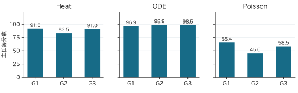

# SciResearch-Bench-Lite

科学计算领域的 Auto Research Benchmark，包含 Heat 初场恢复、ODE 稀疏动力学识别和 Poisson 稀疏求解优化。通过可执行候选、独立真值、私有测试和探索记录，评估 Agent 的交付能力、科学质量、探索收益与适应能力。

## 最新实验：九组 r1 完整结果

**[高清 PDF（22 页）](output/pdf/sciresearch-r1-complete-report-20261101.pdf)** · [完整报告](docs/r1-complete-report-20261101.md) · [离线 HTML](docs/r1-complete-report-20261101.html) · [完整实验附件](https://github.com/bxf1/sciresearch-bench-lite/releases/tag/v0.4-r1-complete-20261101)

实验结果日期为 **2026-11-01**，覆盖 **Heat / ODE / Poisson × G1 / G2 / G3 × r1，共九组配置**。G1 提供详细方法指导，G2 提供方向指导，G3 自主探索；共同任务、数据、工具和预算一致。

| 任务 | G1 r1 | G2 r1 | G3 r1 |
|---|---:|---:|---:|
| Heat | 91.543 | 83.506 | 91.016 |
| ODE | 96.863 | 98.939 | 98.488 |
| Poisson | 65.449 | 45.626 | 58.540 |
| Poisson 端到端加速比 | 3.900× | 2.583× | 3.378× |

九个选定最终候选的主测试均为 **三次 12/12 通过，reward 均为 1**。Heat / ODE 报告精度分，Poisson 报告数值合格后的性能分；不同任务不计算总平均分。



### 独立诊断与主要发现

| 任务 | 每组诊断通过数 | 诊断条件与发现 |
|---|---|---|
| Heat | G1 / G2 / G3 均 10/12 | 改变幅度、频谱与缺失方式；共同失败集中在慢谱衰减，未来场误差小仍可能伴随较大的初场误差 |
| ODE | G1 / G2 / G3 均 12/12 | 非等比例坐标缩放、坐标交换、新稳定三次系统；通过本批诊断不等于任意动力系统上的正确性 |
| Poisson | G1 / G2 / G3 均 12/12 | 256×256 网格、五圆系数区域、交错算子与 RHS；每组缓存逆序检查另为 4/4 |

- **探索收益：** Heat G3 首次至最终提高 0.928 分，ODE G1 提高 0.226 分，Poisson G3 提高 17.310 分。
- **成本权衡：** ODE G1 执行时间中位数由 0.464 秒增至 34.785 秒；独立实现检查发现灵敏度列序问题，封存源码与成绩保持原样。
- **性能解释：** Poisson 加速同时涉及求解方法、因子复用和启动 / 导入开销。正式分采用端到端时间，包含启动、导入、I/O 和求解。
- **统计边界：** 报告展示九组配置，全部记录包含 **10 个研究会话**，其中 ODE G1 为 2 个。全部会话的成本均保留；本批属于案例分析，不据此宣称某种指导强度普遍更优。三次重放和测试实例均不增加独立 Agent 样本数。

## 数据、规则与预算

本批采用新的私有随机根熵，共 **162 个实例**，每任务使用相同的数据评估三组 Agent：

| 划分 | 每任务 | 三任务合计 | 用途 |
|---|---:|---:|---|
| 公开开发集 | 6 | 18 | Agent 自主探索与反馈 |
| 主任务作者校验集 | 12 | 36 | 验收 GT、评分与资源条件 |
| 主任务测试集 | 12 | 36 | 正式主分 |
| 诊断作者校验集 | 12 | 36 | 验收诊断题与参考方法 |
| 诊断测试集 | 12 | 36 | 分析方法边界，不合入主分 |

Heat 使用解析模态与独立变换核验；ODE 使用 DOP853 与 Radau 交叉积分；Poisson 使用制造解、独立通量和小规模直接解检查。评分边界、错误输出、超时与 GT 损坏均有验收记录。各选定候选在对应研究关闭并封存后接受私有测试，测试结果不用于该会话的候选选择。

每会话上限为 **30 分钟、20 次已接受公开评估、200,000 输出 token**；单次模型请求上限 **16,384**，保留正常上下文压缩。研究容器为 **4 vCPU / 4 GiB**，候选执行容器为 **1 vCPU / 4 GiB**。模型路由及可取得的服务商版本声明见冻结材料，后端权重不可变性不作额外保证。

全部十个研究会话耗时合计 **166.87 分钟**，已知输出 **575,944 token**，预算计入 **739,784 token**；预算计入量不等于服务商账单。评估请求、源码版本和可观察本地实验分别记录。

## 报告、结果与证据

| 内容 | 入口 |
|---|---|
| 八部分完整报告及九组方法分析 | [报告正文](docs/r1-complete-report-20261101.md) / [PDF](output/pdf/sciresearch-r1-complete-report-20261101.pdf) |
| 当前九组结果与来源选择 | [结果 JSON](results/r1-complete-20261101/results.json) / [选择清单](results/r1-complete-20261101/selection-manifest.json) |
| 分难度指标、资源与全部会话成本 | [分析 JSON](results/r1-complete-20261101/analysis.json) |
| 逐例结果 | [JSON](results/r1-complete-20261101/case-results.json) / [CSV](results/r1-complete-20261101/case-results.csv) |
| 源码、方法与探索过程 | [方法分析](results/r1-complete-20261101/method-analysis.json) / [探索时间线](results/r1-complete-20261101/exploration-timeline.json) |
| 数据、GT 与冻结验收 | [GT QC](logs/optimized-r1-20261101/gt-qc.json) / [冻结验收](logs/optimized-r1-20261101/freeze-validation.json) |
| 报告数字、字体与逐页排版 | [报告审计](results/r1-complete-20261101/report-audit.json) / [视觉复核](results/r1-complete-20261101/pdf-visual-review.json) |
| 完整原始材料与文件哈希 | [Release](https://github.com/bxf1/sciresearch-bench-lite/releases/tag/v0.4-r1-complete-20261101) / [附件清单](data/r1-complete-20261101/archive-manifest.json) |
| 发布范围与只读核验 | [发布说明](docs/r1-complete-publication-20261102.md) / [发布元数据](data/r1-complete-20261101/publication.json) |

报告使用可选择文本、嵌入字体和矢量图。仓库提供报告、机器可读结果、相关源码及直接引用的证据；Release 附件保留完整数据、GT、原始执行记录和三个原始交付清单。附件中的根 README 是冻结时的历史字节，当前结果从 `START-HERE.md` 和完整报告进入。

```bash
# 检查当前报告、README 数值和发布文件
python3 tools/verify_r1_publication.py

# 下载完整实验附件后逐文件只读核验，不调用模型或执行候选
mkdir -p build/r1-download
gh release download v0.4-r1-complete-20261101 --repo bxf1/sciresearch-bench-lite \
  --pattern sciresearch-r1-complete-evidence-20261101.tar.gz --dir build/r1-download
python3 tools/verify_r1_publication.py \
  --archive build/r1-download/sciresearch-r1-complete-evidence-20261101.tar.gz
```

## 项目入口与历史材料

[调研](docs/survey.md) · [任务卡](docs/task_cards.md) · [Heat](docs/heat.md) · [ODE](docs/ode.md) · [Poisson](docs/poisson.md) · [执行器](runner/) · [独立评分](judge/) · [数据说明](data/README.md)

历史报告和已发布附件保持原有版本。历史 90 例数据见[数据说明](data/README.md)，与本批 162 例分开使用。完整实验附件含参考真值，已公开实例不能再作为新一轮研究的盲测集；研究 Agent 仅应访问对应公开开发输入。
