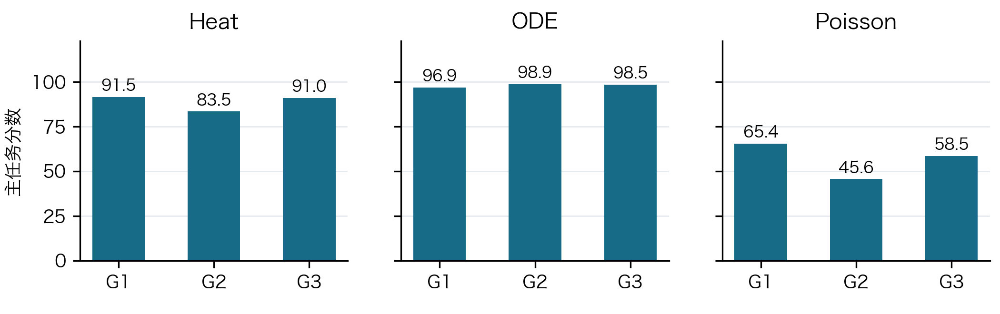
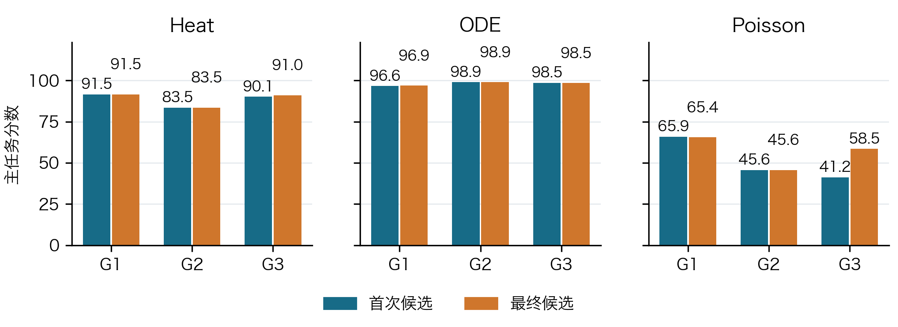
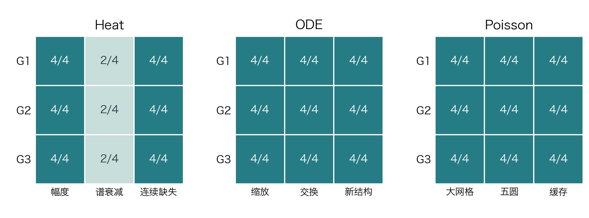

# SciResearch-Bench-Lite 九组 r1 完整实验报告

**完整实验结果 · Heat / ODE / Poisson × G1 / G2 / G3 × r1**

实验范围为 Heat、ODE、Poisson 三任务与 G1、G2、G3 三类指导配置。本文依次介绍问题、GT、规则与校验、开发集、九组探索、测试结果、结论与问题分析。所有成绩均来自封存源码及有效评分记录。

本文汇总九组配置的完整有效结果：九组均封存最终源码，主测试均三次 12/12 通过，reward 均为 1。全部执行记录包含 10 个研究会话；已知输出 575,944 token，预算计入 739,784 token。主任务与独立诊断分别分析，所有执行记录保留。

## 1. 问题定义与实验条件

### 1.1 三类科学计算任务

本实验评估 Agent 能否在有限预算内，理解数据与接口、选择数值方法、开展本地实验、登记可执行候选，并在未知实例上满足精度和资源要求。一个科学样本是一个完整的 Agent 研究会话。测试实例、源码版本、计时重放和基础设施重试都不是新增的独立 Agent 样本。

| 任务 | 已知输入与输出 | 科学难点 | 正式验收 |
|---|---|---|---|
| Heat 反向热传导 | 由有噪、部分缺失的温度观测恢复 256 点初场；输出 `u0.npy` | 扩散会抑制高频，直接求逆放大噪声；观测残差小不保证初场正确 | 初场相对误差 ≤ 0.15，未来场相对误差 ≤ 0.03 |
| ODE 动力系统识别 | 从公开轨迹拟合二维三次多项式向量场；输出 10 × 2 系数矩阵 | 数值微分放大噪声，支撑选择与轨迹拟合可能有不同偏好 | 最多 10 个非零系数；最大轨迹误差与场误差均 ≤ 0.05 |
| Poisson 稀疏求解 | 给定变系数离散算子和四个 RHS，输出四组解 | 精度、稀疏结构、预处理复用与启动开销共同决定效率 | 残差 ≤ 10⁻⁸、解误差 ≤ 10⁻⁵，正式端到端加速比 ≥ 1.5 |

Heat 在区间 [0,1] 上满足 u_t = κu_xx，边界为零。ODE 主任务是带线性与非线性阻尼的 Duffing 系统：q̇₁ = q₂，q̇₂ = −aq₁ − bq₂ − cq₁³ − dq₁²q₂。Poisson 使用正系数、零 Dirichlet 边界和调和平均边系数构成对称正定五点离散系统 AU = B。

### 1.2 保持一致的研究条件

| 项目 | 冻结条件 |
|---|---|
| 报告配置 | 9 组 r1 配置；每任务 G1/G2/G3 各一组结果，实际研究次数单列统计 |
| 指导差异 | G1 提供详细方法指导；G2 提供方向指导；G3 自主探索 |
| 共同预算 | 30 分钟、20 次已接受公开评估、200,000 输出 token（含 thinking 与压缩） |
| 单次模型请求 | 上限 16,384 token；正常上下文压缩保留 |
| 研究容器 | 4 vCPU / 4 GiB |
| 候选执行容器 | 1 vCPU / 4 GiB；单数值线程；无网络、无 swap；128 进程上限 |
| 候选运行限制 | Heat / ODE 每批 120 秒；Poisson 每批 60 秒；输出 256 MiB；临时空间 64 MiB |
| 源码快照 | 独立相对目录，最多 20 MiB / 1,000 文件；完整导出及哈希核验 |

模型路由冻结为 deepseek-flash；启动前取得的服务商文档映射为 DeepSeek-V4.1-Flash-1017，启用 thinking，effort 为 max。该信息是服务商声明的别名映射，不能证明后端权重在运行期间具有不可变身份。共同提示、工具 schema、执行器代码、镜像、依赖和可取得的版本信息均保存哈希。[模型版本证据](../logs/optimized-r1-20261101/provider-documentation.json)

研究均串行执行，共同提示、资源和预算保持一致。九组配置共有十个独立研究会话，ODE G1 对应两次，其余各一次。结果表使用各组选定的最终候选，全部会话的成本和执行记录均保留。

### 1.3 评分与解释边界

Heat 连续分为 100 × [0.8 clip(1 − E_init/0.30, 0, 1) + 0.2 clip(1 − E_forward/0.06, 0, 1)]。ODE 连续分为 100 × [0.5 clip(1 − E_roll/0.10, 0, 1) + 0.5 clip(1 − E_field/0.10, 0, 1)]。二者先按实例计算，再在测试集和规定重放中汇总。

Poisson 连续分为 100 × clip(log(S)/log(8), 0, 1)，S 为三次基线端到端时间的中位数与三次候选时间中位数之比。数值失败是合法零分；计时环境无效则保留数值结果并令正式分数为 null，不能以 0 代替。

三任务使用不同分数含义，本文不计算跨任务总平均分。每组只报告一个选定结果，实际执行次数并非均衡重复设计，因此不进行指导强度的显著性排名，也不推断某组普遍更优。

## 2. 生成 GT 与独立核验

### 2.1 随机性、划分与去重

本批使用新的私有根熵，由任务、用途、主题与实例索引构成独立随机命名空间。同一任务三组使用完全相同的数据。生成后不根据参考方法或 Agent 得分换种子、删除难例或重新抽题。

| 划分 | 每任务 | 三任务合计 | 用途 |
|---|---|---|---|
| 公开开发集 | 6 | 18 | Agent 探索与反馈 |
| 主任务作者校验集 | 12 | 36 | GT、规则与参考方法验收 |
| 主任务测试集 | 12 | 36 | 正式主分 |
| 诊断作者校验集 | 12 | 36 | 新增题与运行可行性 |
| 诊断测试集 | 12 | 36 | 只执行封存最终候选 |

总计 162 个实例。Poisson 诊断主题的正序、逆序及主题视图是同一批文件的字节一致副本，不增加实例数。完整实例与潜在系统的去重规则保留。主任务易例在对比度为 1、网格相同时会自然得到相同恒系数算子，独立 RHS 仍构成不同实例；这一既有例外保持不变。中高难度算子的重复只允许在预声明的缓存诊断配对中发生：同一划分内两个不同算子各配两组独立 RHS，复用对明确标记。[GT 与文件校验](../logs/optimized-r1-20261101/gt-qc.json)

### 2.2 Heat：解析模态与独立变换

初场使用 32 个正弦模态；主任务谱衰减指数在 [1.5, 2.5] 抽取，连续 RMS 归一化为 1。扩散系数 κ 在 [0.5, 1.5] 抽取。各模态按 exp(−κπ²k²t) 解析衰减。噪声按干净观测 RMS 缩放，易、中、难噪声比例为 0.005、0.01、0.02，随机缺失率为 0、0.15、0.30。

GT 以解析模态值生成，再与独立变换实现核对；同时检查初场、零边界、前向传播与半群关系。评分器会对提交的 256 点输出构建完整 256 模态正弦插值，不将提交结果截为 32 模态。这样可避免隐藏高频污染被评分器忽略。

### 2.3 ODE：方程、积分器与能量关系

主任务从 Duffing 系数分布生成动力学。公开数据包括 6 条训练轨迹和 2 条 validation 轨迹，时间区间 [0,6]、301 点；私有轨迹采用不同初值和 [0,8]、401 点，并在 21 × 21 状态网格检验向量场。

GT 使用高精度 DOP853，并以 Radau 独立积分交叉验证；检查多项式库展开、系数与真实方程的一致性，以及解析能量关系。两套积分器在同一解上的相对偏差要求低于 10⁻⁸。真值积分与评分积分分离：GT 使用更严格容差，评分使用固定 DOP853 容差及每轨迹超时约束。

新增稳定三次系统为：

ż₁ = −az₁ + ωz₂ − cz₁³ − ez₁z₂² ż₂ = −ωz₁ − bz₂ − dz₂³ − ez₁²z₂

a、b、c、d、e 独立取 U(0.2,0.8)，ω 取 U(0.5,1.5)。对 V = (z₁² + z₂²)/2，有 V̇ = −az₁² − bz₂² − cz₁⁴ − dz₂⁴ − 2ez₁²z₂² ≤ 0。该系统有 8 个非零系数，仍在原多项式库和最多 10 项的接口约束内，同样完成积分器、库展开和能量检查。

### 2.4 Poisson：制造解与离散算子

主任务网格为 32、64、128，系数对比度为 1、30、300，几何由三个圆区域组成。先构造 U*，再以浮点稀疏乘法生成 B = fl(AU*)。制造解提供已知目标，但评分同时检验相对残差与解误差，不能仅凭残差推断解精度。

独立核验包含通量形式重建、8 × 8 小规模直接求解，以及制造 RHS 的舍入误差界。增大网格、五圆及缓存主题采用相同核验逻辑；缓存主题使用不同算子 A、B 的交错输入顺序及逆序，检查实现是否错误地按位置或旧 RHS 复用结果。

## 3. 定义规则、校验集与验收

### 3.1 规则与 GT 的独立性

规则从任务定义、数值误差、输出接口和资源限制出发冻结。主任务评分分母、门槛及分布保持不变。新增诊断只更改预声明的数据条件；Heat 幅度诊断相应使用实际幅度核验真值归一化，避免把合法的 0.5 倍或 2 倍场误判为 GT 损坏。

主任务作者校验集与诊断作者校验集各 36 例。对全部 72 例，真值导出程序通过评分规则检查，零输出错误对照触发科学失败。真值导出只用于核对规则，不计为可用求解算法，也不计为 Agent 成绩。

评分测试覆盖阈值两侧、恰等于阈值、错误形状、NaN/Inf、超时与 GT 损坏。主任务生成器对 9 个一次性回归样例的输入及私有文件逐字节保持一致，避免新增诊断改变主任务。

### 3.2 主任务参考方法

| 任务 | 作者方法 | 通过 / 12 | 校验数值分 |
|---|---|---|---|
| Heat | 无正则 LS | 0 / 12 | 19.599 |
| Heat | 5 模态 LS | 12 / 12 | 83.346 |
| Heat | 固定 Tikhonov | 12 / 12 | 89.275 |
| Heat | discrepancy Tikhonov | 12 / 12 | 88.027 |
| Heat | TSVD | 12 / 12 | 89.410 |
| ODE | 原始差分 | 0 / 12 | 0.000 |
| ODE | 固定平滑 + STLSQ | 12 / 12 | 95.871 |
| ODE | 公开验证选参 | 12 / 12 | 96.911 |
| Poisson | CG | 12 / 12 | — |
| Poisson | Jacobi-CG | 12 / 12 | — |
| Poisson | LU 复用四 RHS | 12 / 12 | — |

表中都是作者校验集结果，不是私有测试结果。Poisson 此表仅进行数值校验；正式性能校验另用三组 BCCBBC，LU 参考加速比分别为 2.339、2.337、2.342，均达到冻结效率档要求的 1.8 倍校验门槛，因此保持主任务 1.5 倍成功门槛。[正式计时校验](../logs/optimized-r1-20261101/timing-calibration/summary.json)

### 3.3 诊断参考方法与运行可行性

| 任务 / 主题 | 方法 | 通过 | 整批运行秒 |
|---|---|---|---|
| Heat / 全部主题 | 固定 Tikhonov | 10 / 12 | 0.445 |
| ODE / 全部主题 | 固定平滑 + STLSQ | 11 / 12 | 0.443 |
| Poisson / 256 × 256 网格 | LU 复用四 RHS | 4 / 4 | 1.113 |
| Poisson / 五圆系数 | LU 复用四 RHS | 4 / 4 | 0.442 |
| Poisson / 交错算子 / RHS | LU 复用四 RHS | 4 / 4 | 0.445 |

诊断参考方法必须在规定资源内执行并产生合法输出，诊断精度结果如实保留。Heat 10/12、ODE 11/12 的参考通过数说明固定参考方法已有边界；它们不构成更换样本的理由。全部 GT 与规则检查独立通过，因此这里没有将算法失误改写成题目无效。

### 3.4 执行器与资源验收

启动前完成 412 项测试、11 项运行隔离探针、5 项计时探针及真实资源压力验收。模型侧完成离线原生测试、三次请求的合成上下文交接探针和新镜像请求策略捕获：单次输出上限为 16,384，正常压缩后仍恢复该上限。原生工具事件增加宿主时间戳和单调时钟字段，用于探索时间线，不能替代正式性能计时。

计时观察器检查宿主负载、其他容器与 swap。一次候选最多进行三次实际 BCCBBC 测量；未执行候选的安静窗口准入检查另限 12 次。该区分在冻结前明确记录，所有拒绝窗口保留，仍采用首次有效测量，绝不挑最快值。校验期间出现的宿主后台负载没有通过降低门槛规避。[验收与冻结](../logs/optimized-r1-20261101/freeze-validation.json)

## 4. 开发集与可见反馈

每任务提供 6 个公开开发实例，主任务易、中、难各 2 例。G1/G2/G3 共用数据、工具、预算、共同说明及提交提醒，只有方法指导强度不同。私有 GT、作者校验集、主测试集和诊断测试集均不挂载到研究环境。

| 任务 | Agent 可用的公开信息 | 使用与解释 |
|---|---|---|
| Heat | 有噪观测、位置、时间、κ、目标网格；公开反馈为归一化观测残差 R 与粗糙度 | 可做正则化选择和合成试验；R 接近 1 或下降不等价于恢复真值改善 |
| ODE | train 与 validation 两部分带噪轨迹、时间网格、多项式库；公开轨迹反馈 | 两部分均是开发数据，允许联合拟合；私有测试才能支撑独立泛化结论 |
| Poisson | 算子、四个 RHS、数据接口、公开残差与诊断时间 | 可检查精度和优化方向；公开粗计时不能代替宿主隔离的正式 BCCBBC |

Agent 自主决定何时探索、登记和提交。剩余 10、5、2 分钟的提醒只在可交互模型调用边界注入；长命令可能延迟提醒，报告不假定提醒必然及时改变行为。30 分钟硬截止不延长：显式提交使用指定候选，否则使用最新合法登记候选并标注 deadline_fallback；没有候选按规则记零。

## 5. 九组 Agent 在开发集上的探索

### 5.1 交付、用量与探索记录

| 会话 | 首次合法 / 分钟 | 评估请求 / 接受 | 源码版本 | 可见 shell 命令 | 结束状态 |
|---|---|---|---|---|---|
| Heat G1 r1 | 8.63 | 1 / 1 | 1 | 23 | 主动结束 |
| Heat G2 r1 | 6.80 | 1 / 1 | 1 | 36 | 主动结束 |
| Heat G3 r1 | 18.44 | 2 / 2 | 2 | 28 | 主动结束 |
| ODE G1 r1 | 8.02 | 3 / 3 | 3 | 41 | 主动结束 |
| ODE G2 r1 | 26.02 | 1 / 1 | 1 | 24 | 主动结束 |
| ODE G3 r1 | 7.63 | 2 / 2 | 2 | 30 | 主动结束 |
| Poisson G1 r1 | 10.58 | 2 / 2 | 2 | 49 | 主动结束 |
| Poisson G2 r1 | 16.54 | 1 / 1 | 1 | 32 | 主动结束 |
| Poisson G3 r1 | 3.63 | 2 / 2 | 2 | 51 | 主动结束 |

| 组别 | 研究会话数 | 研究分钟（全部） | 已知输出 token | 预算计入 token | 最终选择 |
|---|---|---|---|---|---|
| Heat G1 r1 | 1 | 8.82 | 71,665 | 71,665 | 显式提交 |
| Heat G2 r1 | 1 | 7.77 | 58,799 | 58,799 | 显式提交 |
| Heat G3 r1 | 1 | 19.67 | 81,876 | 81,876 | 显式提交 |
| ODE G1 r1 | 2 | 48.38 | 85,923 | 85,923 | 显式提交 |
| ODE G2 r1 | 1 | 26.31 | 34,957 | 34,957 | 显式提交 |
| ODE G3 r1 | 1 | 9.56 | 45,828 | 45,828 | 显式提交 |
| Poisson G1 r1 | 1 | 15.68 | 93,464 | 142,616 | 显式提交 |
| Poisson G2 r1 | 1 | 19.49 | 56,183 | 170,871 | 显式提交 |
| Poisson G3 r1 | 1 | 11.19 | 47,249 | 47,249 | 显式提交 |

运行期请求证据：共 40 次响应的已知输出超过 4096 token，最大为 16,122 token；原生压缩请求共 4 次。16,384 是单次请求上限；原生压缩及续接/上下文剩余额度可以请求更少 token。单 token 请求共 0 次。

**请求层失败与恢复。** 原生请求重试发生在同一研究 attempt 内，不增加科学会话数。下表时间是失败请求实际占用时间，不含退避，也不从研究总成本扣除。未知输出按冻结策略计入保留额度；“已知输出为零”不表示实际生成量为零。

| 会话 / attempt | 失败请求 | 占用请求秒 | 输出未知请求 | 失败请求计入预算 token |
|---|---|---|---|---|
| Poisson G2 r1 / a001 | 7 | 725.2 | 7 | 114,688 |
| Poisson G1 r1 / a001 | 3 | 142.4 | 3 | 49,152 |

评估请求数按宿主收到的 evaluate 请求计数，另列接受次数；独立版本数按源码哈希计数；工具记录中的 shell 命令数只衡量可观察活动。单条命令可能包含多个拟合或扫描，也可能只是读取文件，因此不将命令数直接命名为“实验次数”。每组方法分析列出日志能确认的本地实验，无法观察的内部尝试不推测。

预算按单个研究会话执行；基础设施重试与独立科学会话在记录中区分。探索表描述纳入结果的会话，成本表包含全部实际会话。ODE G1 的 2 次会话共 48.38 分钟，分别受各自 30 分钟硬截止约束，不表示单个会话放宽预算。

### 5.2 Heat G1 r1：SVD 后验计算与能量约束的先验选择

**方法。** 使用 32 模态前向矩阵，通过加权矩阵 SVD 计算高斯条件均值和方差，再用含均值平方、后验方差和 Student-t 先验尺度的迭代更新调整各模态方差。自由度固定为 4；前两个模态使用宽先验，尾部初始方差按 k⁻³ 衰减。检查总后验二阶矩是否达到 1.95，依次尝试尾部尺度 0.25、0.5、0.9；异常时回退至截断 SVD。

**探索路径。** 先分析六例观测的奇异值、可辨识模态和频谱能量，建立本地估计库，再比较固定 Tikhonov、截断方法和重尾先验，扫描先验参数，并用开发集估计谱生成再观测模拟。若干本地模拟命令发生程序错误，Agent 修改后继续完成试验。共 23 条 shell 命令，但仅登记 1 个独立候选；首次合法登记为 8.63 分钟。

**关键修改与选择。** 探索期修改了迭代更新和模拟中的维度处理，最终采用 SVD 数值实现、尾部尺度选择和兜底逻辑。candidate-001 为首次和最终候选，显式提交后主动结束。因此正式首次/最终结果应复用同一源码哈希，不能把单次公开评估误解为只尝试过一个方法。

**限制。** 1.95 的二阶矩门槛依赖主任务 RMS 归一化规律；它是先验选择条件，并非对输出进行硬归一化。开发集推断谱被用于再观测模拟，日志中以其为“reference”的误差不是私有 GT 误差。对幅度和谱变化的适应性需要独立诊断验证，不能只凭 R 接近 1 或能量接近 2 宣称科学通过。

证据：[solve.py](../research-runs/research-194b4260e84e36bb-heat-g1-r1/registry/snapshots/candidate-001/solve.py)；[state.json](../research-runs/research-194b4260e84e36bb-heat-g1-r1/registry/state.json)；[pi.txt](../research-runs/research-194b4260e84e36bb-heat-g1-r1/auxiliary-agent/pi.txt)。

### 5.3 Heat G2 r1：固定幂律先验的贝叶斯岭回归

**方法。** 在 32 模态正弦前向模型中，使用独立高斯先验 v_k ∝ k⁻²，并把先验总方差固定为 2。按观测噪声 sigma 加权后，直接求解带对角先验精度的 32 × 32 正规方程；线性求解异常时回退至最小二乘。输出按目标网格重建，不直接把输出能量归一化。

**探索路径。** 可观察记录包含环境与公共接口检查、低模态系数和能量估计、多组自定义合成数据试验、先验形状与强度比较，以及最终开发集残差检查。最初两次使用 pandas 的命令失败后改用 NumPy 读取 CSV。共 36 条 shell 命令，其中只有 1 次公开候选登记；sim.py 至 sim6.py 等脚本说明登记前后存在多轮本地试验，不能将公开评估数当作全部探索次数。

**关键修改与选择。** 从观测数据推断的归一化与频谱结构出发，最终固定先验幂次 2、总方差 2，使用 NumPy-only 实现，避免执行时依赖未安装包。首次合法登记在 6.80 分钟，选择 candidate-001 后主动结束；首次与最终源码相同。记录到一次正常原生压缩，没有单 token 请求。

**限制。** 先验总方差 2 和幂次 2 是固定的开发集推断，不随实际场幅度或谱指数自适应。R 接近 1 只说明对公开观测的拟合水平。自建合成数据与真实私有分布未必相同，幅度、谱衰减和连续缺失诊断将分别检查这些边界。

证据：[solve.py](../research-runs/research-194b4260e84e36bb-heat-g2-r1/registry/snapshots/candidate-001/solve.py)；[state.json](../research-runs/research-194b4260e84e36bb-heat-g2-r1/registry/state.json)；[pi.txt](../research-runs/research-194b4260e84e36bb-heat-g2-r1/auxiliary-agent/pi.txt)。

### 5.4 Heat G3 r1：开发集谱包络与 Student-t 收缩

**方法。** 在 32 模态正弦前向模型中建立独立 Student-t（自由度 1）先验，用 IRLS 反复求解 32 × 32 线性系统，最多迭代 60 次。每模态先验尺度来自六例开发观测推断的固定谱包络；高斯 MAP 为初始化和异常回退，最后在给定网格重建初场。

**探索路径。** 可观察记录包括截断最小二乘与谱能量检查、几何谱经验贝叶斯拟合、Gaussian/Student-t 收缩比较、自己定义的合成谱与开发集谱模板再观测、先验尺度扫描。一次经验贝叶斯试验因 Cholesky 非正定失败，一次大规模合成命令在 600 秒后以 124 退出，随后改用小型充分统计量计算与较短模拟。共 28 条 shell 命令、2 次公开评估、2 个独立源码哈希；首次合法登记在 18.44 分钟。

**关键修改与选择。** candidate-001 使用原先验包络；在模板试验后将全部先验尺度乘以 0.5，登记并显式选择 candidate-002。两次公开评估均生成合法输出。会话主动结束，记录到一次正常原生压缩，没有单 token 请求。

**限制。** 尺度包络固定在开发集推断的绝对幅度上，谱形和幅度变化可能影响收缩偏差。日志中的“reference truths”是从公开有噪观测得到的高信噪比估计及合成模板，并非私有 GT；Agent 自报的恢复误差不能当作测试精度。六例模板试验可能偏向开发集谱结构，需由独立诊断检验。

证据：[solve.py](../research-runs/research-194b4260e84e36bb-heat-g3-r1/registry/snapshots/candidate-001/solve.py)；[solve.py](../research-runs/research-194b4260e84e36bb-heat-g3-r1/registry/snapshots/candidate-002/solve.py)；[state.json](../research-runs/research-194b4260e84e36bb-heat-g3-r1/registry/state.json)；[pi.txt](../research-runs/research-194b4260e84e36bb-heat-g3-r1/auxiliary-agent/pi.txt)。

### 5.5 ODE G1 r1：平滑稀疏回归、多支撑选择与轨迹拟合

**方法。** 先用 Savitzky-Golay 平滑求导（31 点窗口、三次多项式）和序贯阈值最小二乘形成基线，联合使用公开 train 与 validation 轨迹。最终版本增加多阈值、显著性筛选和穷举子集 BIC 支撑提议，在最多 10 个非零系数约束下尝试 DOP853 灵敏度积分与加权轨迹残差拟合；数值异常时回退到平滑稀疏回归。

**探索路径。** 先检查六例开发数据，修正本地脚本的维度与返回值错误，再用自建合成轨迹比较支撑筛选和轨迹拟合。还进行了高噪声、边界系统及 12 例批处理规模试验。第 8.02、13.17、17.40 分钟分别登记三个独立源码版本，共 41 条可见 shell 命令、3 次公开评估、38 次成功模型请求。

**关键修改与选择。** 由快速平滑回归扩展到多支撑候选，调整 BIC 候选池，并为最终实现加入 95 秒软预算和异常回退。18.38 分钟时明确提交 candidate-003，主测试首次至最终提高 0.226 分；主测试执行时间中位数从 0.464 秒增至 34.785 秒。资源开销增加远大于此次精度分的改善。

**限制。** 合成有限差分检查发现灵敏度列序与 C.ravel() 的交错系数顺序不一致，相对差异为 1.103；正确重排列后降至 6.47e-11。此项仅为实现诊断，没有修改封存代码或重算成绩，不能单独解释实际得分。95 秒软预算只在支撑循环边界检查，不能保证中途积分及时退出。主任务和三个结构主题均通过，仍不能据此证明任意系统上的适用性。

证据：[solve.py](../research-runs/research-56e485a96415c456-ode-g1-r1/registry/snapshots/candidate-003/solve.py)；[state.json](../research-runs/research-56e485a96415c456-ode-g1-r1/registry/state.json)；[pi.txt](../research-runs/research-56e485a96415c456-ode-g1-r1/auxiliary-agent/pi.txt)；[sensitivity-audit.json](../results/optimized-r1-supplement-20261101/sensitivity-audit.json)。

### 5.6 ODE G2 r1：弱形式支撑搜索与联合轨迹精修

**方法。** 联合使用公开 train 和 validation 轨迹，建立多窗口积分弱形式回归，按观测噪声加权并对部分多项式项做噪声偏差修正。分别对两个坐标构造逐步增项和系数幅度排序路径，用 BIC 型准则及增/删/换项局部搜索选择支撑；随后用 DOP853 轨迹模拟和非线性最小二乘精修系数，最后限制总非零项数不超过 10。最终源码没有把第一坐标方程固定为 z₂。

**探索路径。** 从样条平滑、数值微分和稀疏回归开始，经历数组维度等本地程序错误及一条约 300 秒命令超时，转向积分弱形式；比较共享/分坐标支撑、弱残差选参和轨迹精修，再做 Duffing 与更一般合成系统试验。后一条命令约 900 秒后结束。共 24 条 shell 命令、1 次公开登记、1 个独立源码版本。

**关键修改与选择。** 研究期间修复噪声数组广播、权重和支撑参数打包，最终将已测试的 proto 实现导出为 solve.py。长命令结束后，在剩约 252 秒的模型调用边界出现一次合并了 10/5 分钟阈值的宿主提醒记录；于第 26.02 分钟登记 candidate-001，并显式提交后主动结束。首次与最终哈希相同。提醒发生在交付之前，但本会话不能单独证明提醒的因果作用。

**限制。** 弱形式窗口重叠，BIC 型准则只是选择启发式；超过 10 项时按绝对系数删项，选择不具备坐标缩放不变性。源码的噪声偏差修正覆盖 z₁²、z₁³、z₁²z₂、z₁z₂²，却未修正 z₂² 与 z₂³，可能影响交换坐标和新支撑系统的初始选择。后续轨迹精修能否补偿这些偏差须由私有诊断判断。局部合成命令耗时约占主要研究预算，不能将未完成试验记为已验证泛化。

证据：[solve.py](../research-runs/research-194b4260e84e36bb-ode-g2-r1/registry/snapshots/candidate-001/solve.py)；[state.json](../research-runs/research-194b4260e84e36bb-ode-g2-r1/registry/state.json)；[pi.txt](../research-runs/research-194b4260e84e36bb-ode-g2-r1/auxiliary-agent/pi.txt)；[events.jsonl](../research-runs/research-194b4260e84e36bb-ode-g2-r1/relay-evidence/evidence/events.jsonl)。

### 5.7 ODE G3 r1：平滑导数初始化、振子模板与扩展支撑拟合

**方法。** 将 train 与 validation 联合使用，以平滑样条导数和全库最小二乘得到系数初值，再对候选支撑进行带噪声权重的 DOP853 轨迹匹配。优先尝试四项/五项阻尼三次振子模板及扩展模板，再考虑按导数回归系数排序的通用支撑路径；用拟合代价加复杂度惩罚选型，选定支撑后更严格积分精修。系数最后截去微小值并四舍五入至三位小数。

**探索路径。** 可观察实验包括平滑导数实现与维度修复、支撑集合比较、公开轨迹联合拟合、精度/速度检查及自行构造的非模板合成系统测试。首个本地全搜索版本在开发集约用 40 秒，随后加入模板优先和噪声水平早停策略。共 30 条 shell 命令、2 次公开登记、2 个独立源码哈希，首次合法登记为 7.63 分钟。

**关键修改与选择。** candidate-001 已有模板优先与通用后备搜索；candidate-002 新增两种“模板 + 最强非模板项”的扩展支撑，各最多 10 项，在更宽搜索之前评估。最终显式选择 candidate-002。修改保留了主要拟合、早停和精修逻辑，源码差异可以直接核对。

**限制。** 模板优先和噪声水平早停有助于节省主任务计算，但可能使模型选择依赖开发集结构；非等比缩放也会改变按绝对系数排序的路径。通用及扩展支撑提供适应机会，却增加轨迹优化成本，需检查诊断精度与 120 秒整批限制。诊断只测试最终候选，不能据此分离新增扩展支撑的诊断收益。源码注释声称生成系数位于细小数网格，但作者生成器实际连续均匀抽样且不舍入；该假设不受生成规则支持，三位小数量化的影响需由私有误差衡量。

证据：[solve.py](../research-runs/research-194b4260e84e36bb-ode-g3-r1/registry/snapshots/candidate-001/solve.py)；[solve.py](../research-runs/research-194b4260e84e36bb-ode-g3-r1/registry/snapshots/candidate-002/solve.py)；[state.json](../research-runs/research-194b4260e84e36bb-ode-g3-r1/registry/state.json)；[pi.txt](../research-runs/research-194b4260e84e36bb-ode-g3-r1/auxiliary-agent/pi.txt)；[ode.py](../authoring/ode.py)。

### 5.8 Poisson G1 r1：稀疏 LU、低导入开销与算子因子缓存

**方法。** 对给定稀疏算子做 SuperLU 分解，优先使用 MMD_AT_PLUS_A 排序，一次求解四列 RHS，并以原 CSR 算子复核残差。通过构造最小 Python 包占位并直接导入 SciPy 的 _superlu 扩展减少启动开销；这里仍是 LU 分解，不是 Cholesky。利用任务保证的对称性将 CSR 数组作为转置等价的 CSC 输入；保留完整 SciPy 转换、迭代改进及 NumPy CG 回退分支。

**探索路径。** 日志记录了 49 条 shell 命令，包括比较 LU 排序、带状分解、Jacobi-CG、导入与 I/O 耗时、纯 NumPy 嵌套剖分原型，以及合成大网格。缺失工具、扩展导入与调试错误均保留。约第 10.58 分钟登记首个候选，公开评估两次、对应两个源码哈希。研究内发生三次请求层失败（一次客户端断连、两次上游传输错误），由原生重试恢复；失败请求占用约 142.4 秒，未知输出预留 49,152 token，均保留在成本中。

**关键修改与选择。** candidate-001 到 candidate-002 的源码差异仅加入算子分解缓存，并将求解入口改为缓存查询。键包含维数及完整 CSR 指针、索引和数值字节，不缓存旧 RHS 的解；非零元超过 200,000 时不缓存。最终显式选择 candidate-002。其主测试分数从 65.875 到 65.449，小幅下降；两个独立计时窗口同时存在测量波动，不能将这一差值全归因于缓存。仅最终候选做了缓存诊断，因此不能据此计算缓存改动的因果收益。

**限制。** 直接调用 SciPy 私有扩展和替换模块导入状态依赖冻结环境；回退分支未被本批成功输出证明全部正确。源码中的 NumPy CG 回退用 searchsorted 在整条 CSR 列索引数组上找对角元，但该数组通常仅各行排序，属于静态发现的潜在缺陷，不能解释为本批已经发生的失败。正常 LU 路径通过了本批主测试与全部诊断。256 网格跳过缓存，避免大因子累积；更大或非对称系统不在本批泛化结论内。

证据：[state.json](../research-runs/research-194b4260e84e36bb-poisson-g1-r1/registry/state.json)；[pi.txt](../research-runs/research-194b4260e84e36bb-poisson-g1-r1/auxiliary-agent/pi.txt)；[events.jsonl](../research-runs/research-194b4260e84e36bb-poisson-g1-r1/relay-evidence/evidence/events.jsonl)；[solve.py](../research-runs/research-194b4260e84e36bb-poisson-g1-r1/registry/snapshots/candidate-001/solve.py)；[solve.py](../research-runs/research-194b4260e84e36bb-poisson-g1-r1/registry/snapshots/candidate-002/solve.py)。

### 5.9 Poisson G2 r1：精确算子分组、SuperLU 与多 RHS 复用

**方法。** 规范化 CSR 后，对形状、indptr、indices 和数值数据共同计算 SHA-256，并再做数组精确比较，将相同算子的案例分组。每组用 SuperLU（MMD_AT_PLUS_A 排序、对称模式、优先关闭阈值主元）分解一次，将组内所有 RHS 拼接为块求解；随后检查残差，必要时做一次迭代修正。实际是稀疏 LU，不是 Cholesky 分解。

**探索路径。** 检查公开矩阵结构与重复算子，比较 Jacobi-CG、SuperLU 排序和填充量，单独测量 Python/NumPy/SciPy 导入开销，并尝试自建 128/256 网格。登记直接法后，又开发纯 NumPy 聚合多重网格预条件 CG，修复若干数组维度问题；本地测量后认为其较慢，最终保留已登记的直接法。共 32 条 shell 命令、1 次公开评估、1 个源码哈希，首次合法登记为 16.54 分钟。

**关键修改与选择。** 工作区在候选登记后曾被多重网格原型和新的直接法文本覆盖，但最终显式选择的是不可变快照 candidate-001。正式评分应使用该登记快照，不能重新复制最后的工作区文件。这展示了快照/哈希与按 ID 提交的实际必要性。

**限制。** 直接法在二维网格上的填充与内存会随规模增长；分组仅复用完全一致的算子，数值正确性和顺序独立性仍需私有缓存诊断确认。研究中有 7 次请求层失败（1 次上游超时、6 次传输错误），占用约 725.2 秒请求时间，另有声明退避 24 秒，均在同一 attempt 恢复。失败请求的实际输出未知，按冻结策略计入预算 114,688 token；本会话已知输出 56,183、预算计入 170,871，不能把两者混写。其研究用时受到服务波动显著影响，不能直接归因于指导强度。

证据：[solve.py](../research-runs/research-194b4260e84e36bb-poisson-g2-r1/registry/snapshots/candidate-001/solve.py)；[state.json](../research-runs/research-194b4260e84e36bb-poisson-g2-r1/registry/state.json)；[pi.txt](../research-runs/research-194b4260e84e36bb-poisson-g2-r1/auxiliary-agent/pi.txt)；[events.jsonl](../research-runs/research-194b4260e84e36bb-poisson-g2-r1/relay-evidence/evidence/events.jsonl)。

### 5.10 Poisson G3 r1：带状 Cholesky 与 ctypes 直连 LAPACK

**方法。** 直接读取稀疏 NPZ，以自然顺序将对称算子的下三角装入带状存储。对 n ≤ 256 且带宽 ≤ 4n 的输入，调用 LAPACKE dpbtrf / dpbtrs 做带状 Cholesky 和四 RHS 求解；更大或不适合带状路径的情况回退到 SuperLU。按矩阵数组与维数的摘要缓存因子，640 MiB 缓存上限，按插入顺序淘汰；这不是会随访问更新的 LRU。

**探索路径。** 51 条可见 shell 命令涵盖公开基线与接口阅读、稀疏排序和带状分解比较、完整进程与导入开销、二进制符号探查、LAPACK 调用核对和合成尺度测试。缺少 nm/readelf 等工具后使用 Python 读取 ELF 符号；一次解析脚本错误被修复。约第 3.63 分钟登记 candidate-001，之后继续优化。日志还记录了 768/1024 网格的局部性能试验，但这些自造矩阵不能等同于作者的独立诊断分布。

**关键修改与选择。** 首个版本通过 scipy.linalg 进入带状 Cholesky；第二个版本用 ctypes 直接加载 OpenBLAS/LAPACKE，减少 SciPy 启动开销，将带状路径阈值从 n ≤ 192 改为 n ≤ 256，并将缓存上限从 768 MiB 调为 640 MiB。两次公开评估对应两个源码哈希，显式提交 candidate-002。事后主测试分数从 41.230 提高到 58.540；这是同一会话内固定候选的观察改善。EXPERIMENTS.md 在登记后写入工作区，不属于封存的 candidate-002 源码，方法判断以登记快照及日志为准。

**限制。** ctypes 符号名、整数 ABI 和动态库位置依赖当前镜像。四 RHS 和对称性来自既定接口，不能外推到任意矩阵。带状因子随网格和带宽增大而增长；本批 256 网格诊断虽全部通过，但整批峰值约 583.9 MiB，高于另两组，端到端中位数约 1.308 秒。主任务的启动优化收益不能直接外推成更大网格上的优势。

证据：[state.json](../research-runs/research-194b4260e84e36bb-poisson-g3-r1/registry/state.json)；[pi.txt](../research-runs/research-194b4260e84e36bb-poisson-g3-r1/auxiliary-agent/pi.txt)；[events.jsonl](../research-runs/research-194b4260e84e36bb-poisson-g3-r1/relay-evidence/evidence/events.jsonl)；[solve.py](../research-runs/research-194b4260e84e36bb-poisson-g3-r1/registry/snapshots/candidate-001/solve.py)；[solve.py](../research-runs/research-194b4260e84e36bb-poisson-g3-r1/registry/snapshots/candidate-002/solve.py)。

## 6. 测试集与独立诊断结果

### 6.1 研究关闭与候选封存

每个纳入结果表的候选均在所属研究关闭后封存，再执行对应的私有测试；各候选的关闭时间、源码哈希与评分记录已核验。研究环境只挂载公开开发数据，私有测试反馈没有发送给研究 Agent。结果表按配置列出九个最终候选，成本按全部实际研究会话统计。

首次和最终候选来自登记时的完整不可变快照；同源码哈希可以复用测试结果并标明来源。Heat / ODE 每个不同源码候选重放三次。Poisson 每个候选按 BCCBBC 执行三次基线、三次候选，以中位数之比计时。最终候选另行执行诊断测试，不重新研究、不根据测试结果重新选择。

### 6.2 正式主结果

| 会话 | 最终分 | 三次通过数（各12例） | reward | 正式加速比 | 主结果状态 |
|---|---|---|---|---|---|
| Heat G1 r1 | 91.543 | 12 / 12 / 12 | 1 | — | 有效 |
| Heat G2 r1 | 83.506 | 12 / 12 / 12 | 1 | — | 有效 |
| Heat G3 r1 | 91.016 | 12 / 12 / 12 | 1 | — | 有效 |
| ODE G1 r1 | 96.863 | 12 / 12 / 12 | 1 | — | 有效 |
| ODE G2 r1 | 98.939 | 12 / 12 / 12 | 1 | — | 有效 |
| ODE G3 r1 | 98.488 | 12 / 12 / 12 | 1 | — | 有效 |
| Poisson G1 r1 | 65.449 | 12 / 12 / 12 | 1 | 3.900× | 有效 |
| Poisson G2 r1 | 45.626 | 12 / 12 / 12 | 1 | 2.583× | 有效 |
| Poisson G3 r1 | 58.540 | 12 / 12 / 12 | 1 | 3.378× | 有效 |

九组所选最终候选的主测试均为三次 12/12 通过，reward 均为 1。Poisson G2 的三次候选数值与正式时间来自同一合格 BCCBBC 记录。

图中显示九组有效主分。分面用于区分三类任务，不将其解释为同一能力量尺。

**Heat 分难度误差。** 每格为已执行重放中逐例指标的中位数 / 最大值；通过要求同一实例在所有观察重放通过。

| 组别 | 难度 | 通过 / 4 | 初场误差 | 未来场误差 |
|---|---|---|---|---|
| G1 | 易 | 4 / 4 | 9.47e-03 / 2.30e-02 | 6.11e-04 / 7.61e-04 |
| G1 | 中 | 4 / 4 | 2.88e-02 / 6.81e-02 | 7.49e-04 / 1.33e-03 |
| G1 | 难 | 4 / 4 | 4.01e-02 / 6.97e-02 | 2.02e-03 / 3.54e-03 |
| G2 | 易 | 4 / 4 | 3.78e-02 / 4.52e-02 | 6.11e-04 / 7.59e-04 |
| G2 | 中 | 4 / 4 | 6.79e-02 / 8.42e-02 | 7.39e-04 / 1.21e-03 |
| G2 | 难 | 4 / 4 | 8.10e-02 / 1.05e-01 | 2.03e-03 / 3.65e-03 |
| G3 | 易 | 4 / 4 | 1.63e-02 / 2.51e-02 | 6.10e-04 / 7.60e-04 |
| G3 | 中 | 4 / 4 | 2.68e-02 / 6.51e-02 | 7.46e-04 / 1.25e-03 |
| G3 | 难 | 4 / 4 | 4.43e-02 / 7.17e-02 | 2.01e-03 / 3.59e-03 |

**ODE 分难度误差。** 每格为已执行重放中逐例指标的中位数 / 最大值；通过要求同一实例在所有观察重放通过。

| 组别 | 难度 | 通过 / 4 | 轨迹误差 | 场误差 |
|---|---|---|---|---|
| G1 | 易 | 4 / 4 | 6.97e-04 / 1.78e-03 | 8.67e-04 / 2.40e-03 |
| G1 | 中 | 4 / 4 | 2.84e-03 / 3.70e-03 | 1.99e-03 / 2.23e-03 |
| G1 | 难 | 4 / 4 | 5.19e-03 / 7.05e-03 | 4.91e-03 / 1.46e-02 |
| G2 | 易 | 4 / 4 | 1.43e-04 / 2.27e-04 | 1.74e-04 / 3.10e-04 |
| G2 | 中 | 4 / 4 | 8.39e-04 / 1.13e-03 | 5.50e-04 / 8.76e-04 |
| G2 | 难 | 4 / 4 | 1.92e-03 / 3.53e-03 | 2.87e-03 / 3.62e-03 |
| G3 | 易 | 4 / 4 | 1.20e-03 / 1.71e-03 | 4.09e-04 / 6.43e-04 |
| G3 | 中 | 4 / 4 | 9.87e-04 / 1.43e-03 | 6.50e-04 / 1.18e-03 |
| G3 | 难 | 4 / 4 | 2.83e-03 / 4.36e-03 | 3.13e-03 / 3.69e-03 |

**Poisson 分难度误差。** 每格为已执行重放中逐例指标的中位数 / 最大值；通过要求同一实例在所有观察重放通过。

| 组别 | 难度 | 通过 / 4 | 最大相对残差 | 最大解误差 |
|---|---|---|---|---|
| G1 | 易 | 4 / 4 | 1.78e-16 / 1.84e-16 | 2.04e-15 / 2.26e-15 |
| G1 | 中 | 4 / 4 | 1.99e-16 / 2.05e-16 | 3.74e-14 / 4.08e-14 |
| G1 | 难 | 4 / 4 | 2.09e-16 / 2.19e-16 | 9.95e-13 / 1.24e-12 |
| G2 | 易 | 4 / 4 | 1.85e-16 / 1.90e-16 | 2.15e-15 / 2.32e-15 |
| G2 | 中 | 4 / 4 | 1.90e-16 / 2.01e-16 | 4.03e-14 / 4.65e-14 |
| G2 | 难 | 4 / 4 | 2.09e-16 / 2.16e-16 | 9.91e-13 / 1.15e-12 |
| G3 | 易 | 4 / 4 | 3.46e-16 / 3.51e-16 | 4.18e-15 / 4.69e-15 |
| G3 | 中 | 4 / 4 | 4.92e-16 / 5.16e-16 | 1.40e-13 / 1.76e-13 |
| G3 | 难 | 4 / 4 | 5.33e-16 / 5.46e-16 | 3.19e-12 / 3.78e-12 |

### 6.3 从首次候选到最终候选

| 会话 | 首次分 | 最终分 | 分差 | 源码复用 |
|---|---|---|---|---|
| Heat G1 r1 | 91.543 | 91.543 | 0.000 | candidate-001 |
| Heat G2 r1 | 83.506 | 83.506 | 0.000 | candidate-001 |
| Heat G3 r1 | 90.088 | 91.016 | 0.928 | 否 |
| ODE G1 r1 | 96.637 | 96.863 | 0.226 | 否 |
| ODE G2 r1 | 98.939 | 98.939 | 0.000 | candidate-001 |
| ODE G3 r1 | 98.488 | 98.488 | 0.000 | 否 |
| Poisson G1 r1 | 65.875 | 65.449 | -0.425 | 否 |
| Poisson G2 r1 | 45.626 | 45.626 | 0.000 | candidate-001 |
| Poisson G3 r1 | 41.230 | 58.540 | 17.310 | 否 |

差值是在同一会话内部、相同私有测试集上的事后描述。它不提供重新选候选的机会，也不能作为独立重复试验或因果效果估计。同哈希复用的两端不被计为两次独立算法发现。

### 6.4 诊断测试：数据条件变化后的行为

Heat 每主题 4 例：幅度 0.5 / 2 倍、谱衰减指数 1 / 3 各跨中高难度；连续区间缺失固定 25%，中高难度各 2 例。所有实例保持 32 模态，噪声随干净观测 RMS 缩放。

ODE 每主题 4 例，中高噪声各 2 例：非等比坐标缩放 z = (2q₁, 0.5q₂)、交换坐标 z = (q₂,q₁)、新的稳定三次系统。库、稀疏项数、时间网格与输出接口不变。

Poisson 每主题 4 例，对比度 30 / 300 各 2 例：256 × 256 大网格、128 × 128 五圆系数、128 × 128 交错重复算子与不同 RHS。缓存主题逆序是对相同四例的额外顺序检查，不能当作新增四个实例。

**Heat 诊断。**

| 组别 | 主题 | 通过 / 4 | 最大初场误差 | 最大未来场误差 |
|---|---|---|---|---|
| G1 | 幅度 0.5 / 2 倍 | 4 / 4 | 7.46e-02 | 2.76e-03 |
| G1 | 连续缺失 25% | 4 / 4 | 7.10e-02 | 2.68e-03 |
| G1 | 谱衰减 1 / 3 | 2 / 4 | 3.27e-01 | 3.60e-03 |
| G2 | 幅度 0.5 / 2 倍 | 4 / 4 | 1.32e-01 | 2.73e-03 |
| G2 | 连续缺失 25% | 4 / 4 | 9.19e-02 | 6.32e-03 |
| G2 | 谱衰减 1 / 3 | 2 / 4 | 3.21e-01 | 3.53e-03 |
| G3 | 幅度 0.5 / 2 倍 | 4 / 4 | 6.93e-02 | 2.78e-03 |
| G3 | 连续缺失 25% | 4 / 4 | 7.57e-02 | 4.40e-03 |
| G3 | 谱衰减 1 / 3 | 2 / 4 | 3.27e-01 | 3.58e-03 |

**ODE 诊断。**

| 组别 | 主题 | 通过 / 4 | 最大轨迹误差 | 最大场误差 |
|---|---|---|---|---|
| G1 | 非等比缩放 | 4 / 4 | 9.48e-03 | 1.55e-02 |
| G1 | 坐标交换 | 4 / 4 | 6.45e-03 | 7.70e-03 |
| G1 | 稳定三次系统 | 4 / 4 | 1.23e-02 | 2.48e-02 |
| G2 | 非等比缩放 | 4 / 4 | 2.76e-03 | 5.45e-04 |
| G2 | 坐标交换 | 4 / 4 | 1.68e-03 | 2.89e-03 |
| G2 | 稳定三次系统 | 4 / 4 | 1.84e-03 | 3.99e-03 |
| G3 | 非等比缩放 | 4 / 4 | 1.53e-02 | 5.52e-04 |
| G3 | 坐标交换 | 4 / 4 | 3.05e-03 | 6.62e-03 |
| G3 | 稳定三次系统 | 4 / 4 | 2.44e-03 | 6.98e-03 |

**Poisson 诊断。**

| 组别 | 主题 | 通过 / 4 | 最大相对残差 | 最大解误差 |
|---|---|---|---|---|
| G1 | 交错算子 / RHS | 4 / 4 | 2.07e-16 | 1.12e-12 |
| G1 | 五圆系数 | 4 / 4 | 2.13e-16 | 7.14e-13 |
| G1 | 256 × 256 网格 | 4 / 4 | 2.28e-16 | 1.83e-12 |
| G2 | 交错算子 / RHS | 4 / 4 | 2.07e-16 | 1.15e-12 |
| G2 | 五圆系数 | 4 / 4 | 2.09e-16 | 7.10e-13 |
| G2 | 256 × 256 网格 | 4 / 4 | 2.27e-16 | 1.89e-12 |
| G3 | 交错算子 / RHS | 4 / 4 | 5.32e-16 | 1.26e-12 |
| G3 | 五圆系数 | 4 / 4 | 5.54e-16 | 4.29e-12 |
| G3 | 256 × 256 网格 | 4 / 4 | 7.53e-16 | 8.99e-12 |

图内分母均为每主题 4 个实例。Heat 的失败集中在谱衰减主题；ODE 与 Poisson 三组各主题均通过。Poisson 图中为正序，逆序结果另列表报告。

| 组别 | 顺序 | 通过 / 4 | 最大解误差 | 正式加速比 | 计时状态 |
|---|---|---|---|---|---|
| G1 | 正序 | 4 / 4 | 1.12e-12 | 4.207 | 有效 |
| G1 | 逆序 | 4 / 4 | 1.12e-12 | 4.249 | 有效 |
| G2 | 正序 | 4 / 4 | 1.15e-12 | 2.559 | 有效 |
| G2 | 逆序 | 4 / 4 | 1.15e-12 | 2.563 | 有效 |
| G3 | 正序 | 4 / 4 | 1.26e-12 | 3.804 | 有效 |
| G3 | 逆序 | 4 / 4 | 1.26e-12 | 3.797 | 有效 |

对全部三个组、四个缓存实例和三次 C 重放逐一检查，正序与逆序的同一实例输出文件逐字节相同，共 36 对。[缓存顺序与宿主观察审计](../results/optimized-r1-20261101/observation-audit.json)

### 6.5 资源、计时与失败实例

| 主任务最终候选 | 端到端秒（中位数） | CPU 秒（中位数） | 峰值 MiB（最大） | 实际测量尝试 |
|---|---|---|---|---|
| Heat G1 r1 | 0.269 | 0.397 | 30.7 | 不适用 |
| Heat G2 r1 | 0.227 | 0.379 | 30.8 | 不适用 |
| Heat G3 r1 | 0.225 | 0.371 | 30.8 | 不适用 |
| ODE G1 r1 | 34.785 | 34.560 | 72.6 | 不适用 |
| ODE G2 r1 | 13.965 | 13.968 | 60.4 | 不适用 |
| ODE G3 r1 | 42.785 | 42.679 | 60.2 | 不适用 |
| Poisson G1 r1 | 0.290 | 0.371 | 86.2 | 2 |
| Poisson G2 r1 | 0.440 | 0.523 | 93.2 | 1 |
| Poisson G3 r1 | 0.333 | 0.406 | 115.2 | 1 |

Poisson 各行采用所选合格窗口中的三次候选重放。CPU 与墙钟测量范围不同，不能用两列相除反推候选的并行度。

**Heat 诊断资源。**

| 组别 | 执行范围 | 端到端秒 | CPU 秒 | 峰值 MiB | 加速比 |
|---|---|---|---|---|---|
| G1 | 诊断 12 例整批 | 0.204 | 0.292 | 30.4 | — |
| G2 | 诊断 12 例整批 | 0.164 | 0.264 | 30.6 | — |
| G3 | 诊断 12 例整批 | 0.171 | 0.261 | 30.3 | — |

**ODE 诊断资源。**

| 组别 | 执行范围 | 端到端秒 | CPU 秒 | 峰值 MiB | 加速比 |
|---|---|---|---|---|---|
| G1 | 诊断 12 例整批 | 38.798 | 38.480 | 72.9 | — |
| G2 | 诊断 12 例整批 | 12.619 | 12.648 | 60.7 | — |
| G3 | 诊断 12 例整批 | 48.015 | 47.845 | 60.1 | — |

**Poisson 诊断资源。**

| 组别 | 执行范围 | 端到端秒 | CPU 秒 | 峰值 MiB | 加速比 |
|---|---|---|---|---|---|
| G1 | 交错算子 / RHS | 0.213 | 0.319 | 59.9 | 4.207 |
| G1 | 交错算子 / RHS（逆） | 0.211 | 0.316 | 60.1 | 4.249 |
| G1 | 五圆系数 | 0.244 | 0.347 | 77.8 | 3.947 |
| G1 | 256 × 256 网格 | 0.683 | 0.753 | 118.9 | 6.710 |
| G2 | 交错算子 / RHS | 0.351 | 0.451 | 78.0 | 2.559 |
| G2 | 交错算子 / RHS（逆） | 0.349 | 0.450 | 77.9 | 2.563 |
| G2 | 五圆系数 | 0.384 | 0.487 | 81.3 | 2.527 |
| G2 | 256 × 256 网格 | 0.897 | 0.967 | 191.2 | 5.126 |
| G3 | 交错算子 / RHS | 0.236 | 0.337 | 71.0 | 3.804 |
| G3 | 交错算子 / RHS（逆） | 0.235 | 0.334 | 70.7 | 3.797 |
| G3 | 五圆系数 | 0.278 | 0.379 | 105.1 | 3.480 |
| G3 | 256 × 256 网格 | 1.308 | 1.369 | 583.9 | 3.530 |

端到端时间包含进程启动、导入、I/O 和求解。CPU 与峰值内存来自可信执行器，候选自报的内部阶段时间不参与正式加速比。Heat / ODE 诊断资源值对应 12 例整批，不能将同一个整批值当成各主题独立耗时。Poisson 诊断按主题分别计时。

九组主任务均通过各自的科学与效率门槛。诊断失败实例仍完整保留在逐例结果中。

**Heat 的诊断失败发生在初场恢复质量上。** 三组均在谱衰减指数为 1 的中、高难度两例上未通过初场误差门槛，主题最大初场误差约 0.321-0.327，但未来场最大误差仍低于 0.004。扩散后的良好拟合可能掩盖高频恢复不足。指数为 3 的两例、幅度和连续缺失主题均通过。

**实现检查与科学通过分别解释。** ODE G1 虽通过全部主测试和诊断，灵敏度列序检查仍发现缺陷，且最终候选只获得有限分数收益。通过有限样本不能替代实现正确性检查；没有将实现风险擅自改判为科学失败。

**计时使用合格观测。** Poisson 三组正式结果均来自满足冻结条件的 BCCBBC 记录。拒绝窗口和请求层失败保留在执行证据中；所有有效窗口均有完整宿主观测覆盖，不选择最快重放。

**诊断失败实例。** 同一数据由三组共享，因此重复 ID 表示不同候选在同一实例上的结果。

| 会话 | 主题 | 实例 ID | 误差 |
|---|---|---|---|
| Heat G1 r1 | 谱衰减 1 / 3 | 6f5b711df1b95d91d9b1 | E_forward=7.54e-04, E_init=2.33e-01 |
| Heat G1 r1 | 谱衰减 1 / 3 | 0bdb0aeb8c526c94318f | E_forward=1.27e-03, E_init=3.27e-01 |
| Heat G2 r1 | 谱衰减 1 / 3 | 6f5b711df1b95d91d9b1 | E_forward=7.52e-04, E_init=2.23e-01 |
| Heat G2 r1 | 谱衰减 1 / 3 | 0bdb0aeb8c526c94318f | E_forward=1.24e-03, E_init=3.21e-01 |
| Heat G3 r1 | 谱衰减 1 / 3 | 6f5b711df1b95d91d9b1 | E_forward=7.63e-04, E_init=2.35e-01 |
| Heat G3 r1 | 谱衰减 1 / 3 | 0bdb0aeb8c526c94318f | E_forward=1.30e-03, E_init=3.27e-01 |

逐例误差、通过判定、重放序号、资源与失败原因保留在 [机器可读分析](../results/r1-complete-20261101/analysis.json)、[逐例 JSON](../results/r1-complete-20261101/case-results.json) 和 [逐例 CSV](../results/r1-complete-20261101/case-results.csv)。

## 7. 结论

**交付能力。** 九组配置均有封存的可执行候选，首次合法登记约 3.63-26.02 分钟。全部 10 个研究会话实际占用 166.87 分钟，宿主 attempt 墙钟合计 176.88 分钟；后一指标包含启动与收尾，不含后续评分等待。已知输出 575,944 token，预算计入 739,784 token；预算计入量不等于服务商账单。

**科学质量。** 九个最终候选主测试均三次 12/12 通过，九组 reward 均为 1。Heat 分数为 91.543、83.506、91.016；ODE 为 96.863、98.939、98.488；Poisson 正式加速比分别为 3.900、2.583、3.378 倍。不同任务分数不能合并为统一能力量尺。

**探索收益。** Heat G3 首次至最终提高 0.928 分，ODE G1 提高 0.226 分，Poisson G3 提高 17.310 分。ODE G1 的时间开销明显上升，表明更多复杂拟合未必划算。Poisson G1 下降 0.425 分，不能据此区分算法收益与计时波动；ODE G3 两个不同源码版本的主测试指标相同。公开评估次数不能代表全部探索量。

**适应能力。** Heat 三组诊断均为 10/12，共同边界在慢谱衰减主题。ODE 三组均为 12/12；Poisson 三组均通过各主题及缓存逆序检查。36 对已保存的正逆序缓存输出逐字节相同；这只覆盖本批两个算子及四组 RHS 的排列，不证明任意缓存序列安全。

本报告的九组配置用于案例分析，结论适用于这些任务、模型路由、预算与数据。三次重放检验可执行性和计时稳定性，12 个测试实例刻画实例分布，均不增加 Agent 样本数。本文不报告提示组别显著性排名。

## 8. 问题分析与后续改进

### 8.1 交付效率与执行保障

保留自主探索和硬截止，将长命令改为可轮询作业，提供剩余预算状态，并在共同说明中解释长阻塞可能延迟提醒。全部执行记录包含一次 ODE G1 未登记候选的会话；九组结果表对应各组选定的最终候选，不能据此宣称所有启动都在首次研究中交付成功。成本表保留全部会话用量。

选定会话每组登记 1-3 个源码版本，20 次公开评估额度并非主要瓶颈。优先降低本地调试与反馈等待成本，避免先增加评估额度。ODE G1 已提供可运行基线，但复杂拟合增益很小，应结合精度与资源开销决定是否继续迭代。

### 8.2 科学指标与方法边界

Heat 应同时关注可辨识模态、先验敏感性和初场不确定性；观测残差与未来场误差容易遗漏高频偏差。可在统一开发工具中加入合成压力试验，检验幅度与谱先验的适应性。本批没有证明某一种修正必然解决慢谱衰减问题。

ODE 应保留轨迹和向量场双指标，明确 train/validation 都是开发数据。G1 的解析雅可比必须先与有限差分核对；G2 的噪声修正不覆盖所有坐标幂次，G3 的系数取整依据与真实连续分布不符，均需针对性检查。三个方法在本批结构诊断均通过，不能把源码风险直接写成已发生的测试失败。

Poisson 应分开报告完整进程性能与求解阶段解释。G1/G3 减少导入开销，但私有扩展和 ctypes 接口降低依赖可移植性；G2 的标准 SuperLU 接口更直接，网格扩大后的填充与内存仍需评估。启动优化与分解规模效应应分别分析。

### 8.3 计时与实验设计

正式性能测量应使用专用、可控的宿主，保持固定 BCCBBC 顺序、预先声明的尝试上限、首次有效选择和全部拒绝记录。数值正确性与计时资格分开记录，不能把环境无效改写为算法零分或选择最快时刻。

下一版观察器可事先将异常采样间隙纳入拒绝规则，并保存单调时钟与墙钟对照。当前策略禁止新 swap-out，将无法归因的全局 swap-in 作为诊断；候选容器自身禁止 swap，两者须清楚区分。

本报告是九组配置的案例分析。执行次数和候选选择过程并非均衡重复设计，因此不做指导强度的显著性排名。若研究普遍效果，需另行预注册独立会话与随机化区组；增加计时次数和测试实例不能替代独立 Agent 样本。

### 8.4 审计范围与证据限制

宿主记录能够确认候选登记、哈希、公开评估、最终选择、研究关闭、用量与测试执行；原生工具事件和源码共同支持方法分析。工具输出有截断可能，工作区中的说明也不能证明所有未记录实验。内部推理和日志外活动不作为可核验的实验事实。

模型版本只取得服务商声明与请求/响应可观察信息；固定随机种子不等于模型生成确定性。主任务与诊断仍然是有限的合成分布，诊断通过不代表任意分布泛化。少量主题实例和每组单个选定结果用于发现具体失效机制，不支持总体概率估计。

冻结清单、数据与 GT 校验、执行器验收、探索时间线和逐例结果构成可复核证据链。九组配置对应十个实际研究会话，ODE G1 采用最后一个独立会话封存的 candidate-003；此前一次会话没有登记候选，其 30 分钟和 18,327 输出 token 保留在总成本中。选择过程不构成均衡随机重复设计。报告构建不触发任何新模型研究或候选执行。主结果及诊断使用同一最终快照，图表数字来自机器可读分析。

| 证据 | 文件 |
|---|---|
| 冻结运行计划 | [plan](../freezes/research-run-plan-optimized-r1-20261101.json) |
| 探索时间线 | [timeline](../results/r1-complete-20261101/exploration-timeline.json) |
| 封存后的原始结果 | [results](../results/r1-complete-20261101/results.json) |
| 汇总与成本 | [analysis](../results/r1-complete-20261101/analysis.json) |
| 方法证据与判断 | [methods](../results/r1-complete-20261101/method-analysis.json) |
| 数据与 GT 检查 | [GT QC](../logs/optimized-r1-20261101/gt-qc.json) |
| 服务恢复 | [restoration](../logs/optimized-r1-20261101/study-service-restoration.json) |

PDF 使用可选择文本、嵌入 TrueType 字体和 SVG 矢量图；逐页渲染检查与字体/文本检查记录随报告交付。
