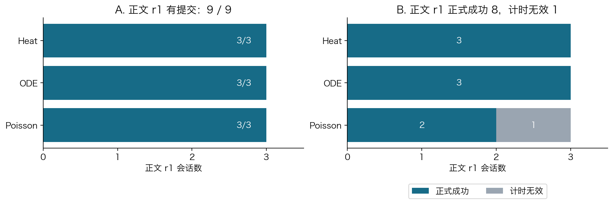
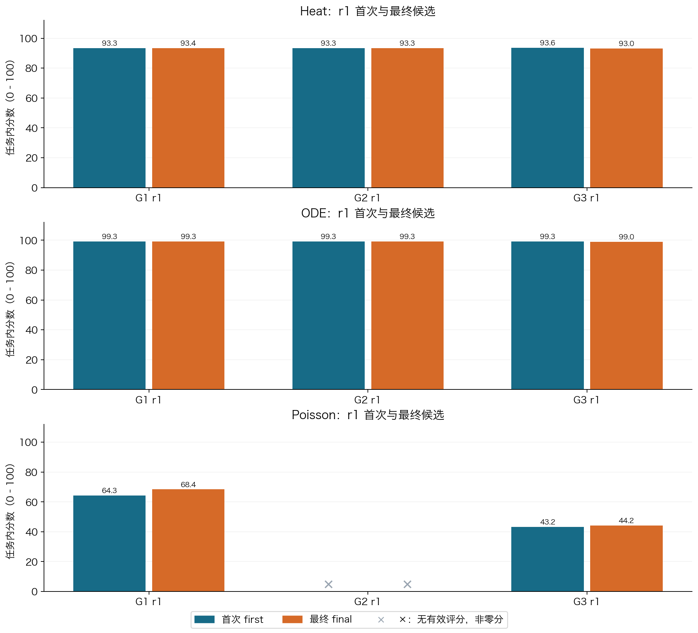
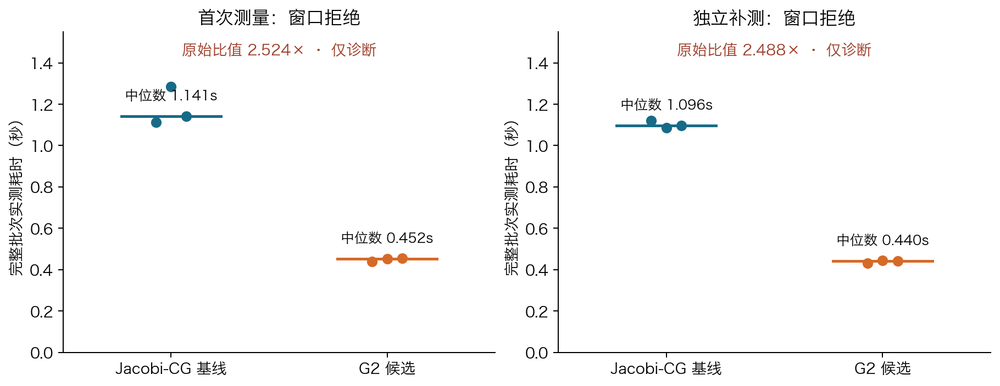

# SciResearch-Bench-Lite：科学计算自主研究基准设计与实验报告

**课程作业最终报告 · thinking/max · 正文 r1 版 · 2026 年 10 月 25 日**<br>
研究领域：科学计算；提交形式：个人 GitHub 仓库。<br>
**[提交仓库](https://github.com/bxf1/sciresearch-bench-lite)** · [阅读打印版 PDF](../output/pdf/sciresearch-thinking-r1-report-20261025.pdf) · [离线阅读版 HTML](submission-report-2026-10-24.html) · [完整材料与 Release](https://github.com/bxf1/sciresearch-bench-lite/releases/tag/v0.3-submission-20261024)

## 摘要与阅读说明

本项目关心一个具体问题：**AI 能否在有限时间和工具预算内，把科研任务转化为可运行的方法，并利用实验反馈改进结果？** 为此，在科学计算领域实现了三条任务：从温度观测恢复初始温度分布（Heat）、从带噪运动轨迹识别动力学方程（ODE）、在保证解正确的前提下加快稀疏方程求解（Poisson）。三条任务共生成 90 个合成实例，配置了 11 种作者基线，并由独立程序验证候选代码的输出。

本报告仅讨论 **thinking=enabled、effort=max** 条件。正文统一展示三任务、三指导组各自的 r1，共 **9 个会话**；Heat 的 r2、r3 共 6 个会话放在附录。正文 9/9 形成通过公开产物检查的提交，8/9 取得有效且成功的最终成绩。Poisson G2 数值检查通过，但正式计时不合格，正式分数留空；独立补测原始耗时比 **2.488× 仅作诊断**。每会话最多 20 万输出 token、30 分钟、20 次公开评估。本批作者基线 10 项取得有效结果，Jacobi-CG 独立窗口拒绝；三任务均有有效基线验证。

这些结果表明，项目已形成“任务—数据—Agent 实验—可信提交—独立评分—日志分析”的可运行闭环。会话内迭代既有改进也有退化，执行器故障和宿主计时干扰也会影响结果。中途修复、已使用过的隐藏集及小样本限制了结论，不能据此宣称 thinking 的因果收益或真正的递归自我改进。

**版本范围：** 上一版跨批比较报告、图表、数据和生成脚本已[完整暂存](../archives/pre-thinking-only-20261025/README.md)，原 Release 附件保留。本版主表、图表、用量与端到端案例采用 thinking 批次的 r1；附录完整保留 r2/r3。上一版 thinking 全表 PDF 与 Release 附件也保留，原始数据和重试关系未删改。

**读表约定：** 分数保留三位小数；`0` 是按规则得到的零分，`—` 是没有有效成绩，两者不同。`reward=1` 表示满足该任务全部成功条件，`reward=0` 表示有效评测下未成功。正文按 **Heat → ODE → Poisson、G1 → G2 → G3** 排列 r1（M01–M09）；附录按组排列 Heat r2/r3（A01–A06）。实际执行序号另列。完整精度和来源哈希见[整理后的数据](../results/thinking-r1-report-2026-10-25/analysis.json)。

## 1. 背景与研究目标

普通问答往往只检查最终答案；科研工作还要求选择方法、实现代码、设计实验、识别失败并修改方案。一个程序能运行，不一定得到了正确科学结果；一次公开测试表现好，也不一定能推广到新的测试样本。因此，Auto Research Benchmark 需要同时评价研究过程与最终产物。

本报告采用以下工作定义：Auto Research 指让 Agent 自主完成方法选择、实验和改进；AI Scientist 的范围可以进一步包括提出想法、文献分析、写作与评审；Research Agent 是执行这些工作流的工具使用系统。RSI（Recursive Self-Improvement，递归自我改进）则要求系统修改自身的策略、工具或代码，并验证改进能作用于后续任务。**本项目测量的是 Agent 对当前求解器的研究与改进，没有把模型或 Agent 自身作为优化对象。**

选择科学计算有三个原因：第一，热方程、常微分方程和线性系统都有明确数学结构；第二，可以生成数据并独立构造参考真值；第三，任务规模适合个人机器运行。代价是实验主要代表受控合成问题，不能直接外推到实验室发现或开放世界科研。

项目围绕四个问题组织：

1. 三条任务是否具有完整的数据、环境、基线和独立自动评分？
2. 给予不同强度的方法指导后，Agent 能否形成有效提交？
3. 同一会话首次与最终候选相比，是否出现可核验的改进或退化？
4. 数值正确性、计算效率、资源开销与执行可靠性之间有什么关系？

后文“是否符合预期”是依据任务机制的事后分析，不冒充预注册的统计假设检验。本报告不比较开启与关闭 thinking 的效果。

## 2. 相关工作调研与设计借鉴

下表比较了六项相关工作。前四项依据论文，后两项同时依据本地固定版本的官方源码。详细源码位置、工作流图与版本说明见[调研文档](survey.md)。

| 工作 | 任务、环境与工具 | 评价方式 | 本项目借鉴及局限 |
|---|---|---|---|
| [AI Scientist-v2](https://arxiv.org/abs/2504.08066) | 提出假设，管理机器学习实验，执行代码并撰写论文；使用实验管理与树搜索 | 实验指标、图文检查和论文评审 | 借鉴“假设—实验—分析—修订”；论文质量与数值正确性不能用同一指标概括 |
| [ScienceAgentBench](https://arxiv.org/abs/2410.05080) | 从科研论文抽取数据分析任务，要求生成可执行 Python 程序 | 检查程序、运行产物与成本 | 借鉴可执行产物验收；完成指定分析不等于提出原创科学理论 |
| [MLGym](https://arxiv.org/abs/2502.14499) | 可执行的机器学习研究环境，支持方法实现、训练、实验及反馈迭代 | 任务性能指标及实验轨迹 | 借鉴公开反馈驱动的迭代；跨任务指标与计算预算需要分别校准 |
| [Darwin Gödel Machine](https://arxiv.org/abs/2505.22954) | 修改 Agent 自身代码，并保留不同后继版本 | 使用编程基准实测改动效果 | 帮助界定 RSI；编程能力提升不能自动等同于科学研究能力提升 |
| [ASI-Bench](https://github.com/apexin-ai/ASI-Bench/tree/b100adef1acef9e38cc2cea298f2d07a8cc1fd84) | 在同一科研项目中改变方法指导信息，Agent 选择方法并调用工具 | 产物合法性门槛、任务评分、运行与评价状态 | 借鉴匹配的信息条件；本项目 G2 只给方向，不完全复刻其 B2 方法提示 |
| [Terminal-Bench-Science](https://github.com/harbor-framework/terminal-bench-science/tree/de562a2863f372795d7dd09ff28876f779b3aa33) | 专家设计的终端科研工作流；任务包包含指令、环境、测试和参考解 | 独立任务测试，并通过参考解、空操作和对抗检查维护质量 | 借鉴任务包、隔离执行和客观验收；真实任务的依赖维护与专家制作成本较高 |

两项主要参考各解决了一类问题：ASI-Bench 启发我们在保持任务目标和评分一致时，改变给 Agent 的方法指导；Terminal-Bench-Science 启发我们把题目做成真正可运行、可测试、可复查的任务包。本项目将两者结合，用三种指导强度研究同一数值任务，并将结果交给独立判题程序。

现有工作的共同挑战包括：任务和环境差异会干扰模型比较，最终分数难以解释过程失败，公开反馈可能被过拟合，以及真实科研的新颖性很难完全自动评分。本项目通过统一接口、固定预算、隐藏测试和细分失败状态降低这些问题，但并未解决全部开放科研评价难题。

## 3. Benchmark 任务与数据构建

### 3.1 三条任务分别考察什么

| 任务 | 通俗解释与研究难点 | 输入 | 必须提交的产物 |
|---|---|---|---|
| T1 / Heat：热方程初场恢复 | 热量扩散会抹平细节；根据较晚、带噪、缺失的温度观测推回最初分布，需要防止噪声被放大 | 时空温度观测、扩散系数、256 点目标网格 | 每例一个 `u0.npy` 初场数组 |
| T2 / ODE：稀疏动力学辨识 | 从多个初始状态的带噪轨迹中找出运动方程；既要拟合观测，又要用少量项预测新轨迹 | 6 条训练轨迹、2 条公开验证轨迹、时间和精确初值 | 一个 `(10,2)` 多项式系数矩阵 `model.json` |
| T3 / Poisson：稀疏求解优化 | 求解 `A U = B`；矩阵很大但多数元素为零，四个右端项可共享计算，要求既正确又快 | 稀疏矩阵 `A.npz`、四列右端项 `rhs.npy` | 每例一个 `(n*n,4)` 的 `solution.npy` |

三条任务使用统一候选入口：`python solve.py --input /input --output /output --seed 0`。Agent 可以读写研究工作区、调用终端、编写和运行 Python、进行局部试验并调用公开评估工具。它提交相对源码目录，由宿主复制为只读候选快照；最终提交必须引用已登记候选，不能由 Agent 自报一个分数代替程序产物。

### 3.2 数据来源、划分与清洗

数据来自明确的数学模型，属于**合成数据**，不是外部实测数据采集。每条任务生成 30 例，共 90 例；本轮在冻结后的固定数据划分上运行。

| 划分 | 每任务数量 | 三任务合计 | 易 / 中 / 难数量（每任务） | 用途和可见范围 |
|---|---:|---:|---|---|
| public-dev | 6 | 18 | 2 / 2 / 2 | Agent 研究时可见，获得有限的公开诊断反馈 |
| author-calibration | 12 | 36 | 4 / 4 / 4 | 作者基线和评测规则验收，研究 Agent 不可见 |
| final-test | 12 | 36 | 4 / 4 / 4 | 研究关闭后的独立最终评价，研究 Agent 不可见 |
| 合计 | 30 | 90 | 10 / 10 / 10 | 三种角色的数据彼此分开 |

Heat 用 32 个正弦模态构造初场，按热方程产生后续观测，再加入缺测和高斯噪声；难度随观测延迟、缺失和噪声改变。ODE 生成二维三阶多项式系统的多初值轨迹，并按通道幅度加噪；难点在于噪声导数、稀疏结构及长时预测。Poisson 构造正系数离散扩散矩阵及四列制造解，设 `B=A U*`；三个档位使用网格边长 32/64/128 和系数对比度 1/30/300。

“清洗”在这里指生成后的质量检查（QC）：数值是否有限、形状与参数是否合法、是否出现非预期重复、真值能否被独立方法交叉验证、文件是否完整。Heat 用独立传播方式和方程残差核对；ODE 用另一种积分器交叉核对；Poisson 检查矩阵性质及独立通量复算。**90/90 例通过 QC；没有根据 Agent 得分删掉困难样本。** 随机流由命名空间和根熵派生，文件保留 SHA256 以检查一致性。

仓库包含 18 例公开输入；完整 90 例输入、作者真值、QC 和生成记录在 Release 的 `author-data-v0.3.tar.gz`。详见[数据索引](../data/README.md)、[任务卡](task_cards.md)与[逐文件清单](../data/file-manifest.json)。完整作者数据发布用于复核，但未来研究运行仍必须隔离真值；公开后的旧隐藏集不能继续被宣称为全新盲测集。

## 4. 实验设计与编号说明

### 4.1 G1、G2、G3 是指导强度

| 编号 | 提供给 Agent 的信息 | 本项目想观察的能力 |
|---|---|---|
| G1 | 共同任务契约，加详细方法指导 | 能否把较明确的方法实现并完成实验 |
| G2 | 共同任务契约，加研究方向；不提供具体算法名 | 能否从方向构建具体可行方案 |
| G3 | 共同任务契约：目标、输入、工具、产物和约束 | 能否自主选择方法并验证结果 |

组别改变的是方法提示；输入、工具、预算、输出格式和科学成功条件保持一致。G3 仍有完整任务说明，并非没有任何信息。

### 4.2 r1、r2、r3 是什么

**r 是 repeat（重复运行）的缩写。** 例如，`Heat G2 r3` 表示“热方程任务、G2 方向指导组、第 3 次独立研究会话”。每次从新的研究工作区开始，不继承同组上一次的候选。重复运行用于观察同一条件下表现是否稳定。

必须区分以下三种“重复”：

| 标记或操作 | 含义 | 是否增加独立研究样本 |
|---|---|---|
| r1 / r2 / r3 | 同一任务和指导组的第 1 / 2 / 3 个研究会话 | 是；但仍共享任务数据、模型和宿主条件，不代表独立数据集 |
| a001 / a002 | 同一研究会话的执行尝试；a002 是明确关联的基础设施恢复重试 | 否；失败记录与开销另存，不把两次尝试算成两个科学样本 |
| 同一候选评分重放三次 | 提交后的程序在隔离环境重复执行，核对数值和运行表现 | 否；重复使用同一组 12 个测试实例，不变成 36 个独立测试例 |

`r2` 不是中等难度，`r3` 不是最终改进版，也不代表换了隐藏测试集。本轮求解器种子固定为 0；研究会话独立启动并不意味着拥有三个不同的数学数据种子。`first` 是可信登记中确定的首次候选，`final` 是会话最终指定候选；final 不是事后挑选隐藏成绩最高的版本。

### 4.3 正文与附录的统计范围

| 任务 | 正文展示 | 附录保留 | 原冻结计划会话数 |
|---|---|---|---:|
| Heat | G1 r1、G2 r1、G3 r1：3 个 | 各组 r2、r3：6 个 | 9 |
| ODE | G1 r1、G2 r1、G3 r1：3 个 | 无额外重复 | 3 |
| Poisson | G1 r1、G2 r1、G3 r1：3 个 | 无额外重复 | 3 |
| 合计 | 9 个 | 6 个 | 15 |

**这是报告排版与展示范围的调整，原实验计划仍是 15 个会话。** 正文统一选择每组首次计划运行 r1，不按成绩挑选；这是完成实验后确定的展示规则，不冒充预注册统计子集。r1 使用事先登记的保留 attempt，两个关联重试仍对应原会话，不能把 a001/a002 当成 r1/r2。

正文的提交率、成功率、用量和迭代计数均以 9 个 r1 为范围；附录单列 6 个重复实验及完整批次统计。正文每组只有一次结果，可展示端到端过程，不能判断稳定性或组间普遍优劣。

### 4.4 模型与冻结预算

| 项目 | 本轮 thinking/max 设置 |
|---|---|
| 研究框架 | Harbor / 原生 Pi；执行期间发生三次基础设施修复，见第 9 节 |
| 模型路由 | `deepseek-flash`；冻结时记录为 DeepSeek-V4.1-Flash-1017，不能独立锁定供应商内部修订 |
| thinking / effort | enabled / max，由可信 relay 强制执行 |
| temperature / top_p | thinking 模式 temperature 不生效，记录 null；top_p=1 |
| 单请求输出上限 | 4,096 token |
| 每会话累计输出上限 | 200,000 token，包含 thinking、普通输出及原生压缩 |
| 每会话其他上限 | 1,800 秒；20 次公开评估，任一预算先到则停止 |
| 科学参数 | 数据、提示、顺序、评分、种子及研究资源按冻结计划执行 |

[冻结计划](../freezes/research-run-plan-thinking-max-2026-10-25.json)的 SHA256 为 `25c3250f8615aa5a90a24206964533085b5448f06910f7e42a969e2f66763f0e`。基础设施修复通过独立、哈希绑定的附录记录，没有提高请求或会话预算。本轮为事后追加的实验，沿用已使用过的隐藏集，不能称为全新盲测；当前报告只描述本轮表现，不估计 thinking 单独带来的收益。

## 5. 运行环境、评测规则与隔离

### 5.1 从研究到评分的执行流程

1. **生成并冻结数据**：作者构造输入、参考真值和 QC，分开公开与隐藏部分。
2. **Agent 开展研究**：研究容器只能读取公开数据，编写候选并获得公开反馈。
3. **可信提交登记**：宿主对源码生成只读快照，记录候选 ID 与哈希。
4. **关闭研究**：本批全部研究关闭后，才开放最终隐藏评分；评分结果不会回灌仍在进行的研究。
5. **独立执行与判题**：全新 W 容器运行候选；J 容器读取数值产物及真值完成判断。
6. **保留全链证据**：记录分数、成功标记、资源与用量、候选版本、错误及原始日志。

实际环境为 M4 MacBook Air 上的 Colima Linux aarch64。研究容器 R 为 4 vCPU / 4 GiB；候选容器 W 为 1 vCPU / 4 GiB、单数值线程、无网络且禁 swap。数值环境固定 Python 3.12.12、NumPy 2.2.6 和 SciPy 1.15.3，镜像与源码哈希均留档。W 不接触真值和 Judge 代码；J 不运行候选源码，只检查产物。模型凭据由研究容器外的 relay 管理。

这一区分很关键：Agent 可以声称“已经正确”，但最终成绩来自独立程序对文件的检查。详见[隔离协议](protocol.md)和[复现指南](reproduction.md)。

### 5.2 正确性、研究效果、效率与可复现性

| 维度 | 本项目如何测量 | 读数含义 |
|---|---|---|
| 正确性 | 文件格式、形状、有限数；隐藏数值误差和科学约束 | 程序是否交付了符合任务要求的结果 |
| 研究效果 | 任务连续分数；全例成功的 reward；first → final 差异 | 结果质量及会话内迭代是否改善 |
| 实验效率 | 输出 token、墙钟时间、公开评估次数；Poisson 完整批次速度 | 为获得产物付出了多少资源，求解器是否够快 |
| 可复现性 | 数据/源码/镜像哈希、冻结配置、候选快照、独立重放与日志 | 他人能否定位同一材料并重复核验；速度仍需新环境验收 |

### 5.3 三条任务的成功条件和分数

| 任务 | 单例科学门槛 | 全会话成功条件 |
|---|---|---|
| Heat | 初场相对误差 ≤0.15，未来场误差 ≤0.03 | 12 个 final-test 实例全部通过 |
| ODE | 阈值化后非零系数 K≤10；四条隐藏长轨迹的最大相对误差 ≤0.05，隐藏向量场误差 ≤0.05 | 12 例全部通过，且产物、积分及结构约束合法 |
| Poisson | 每列真实相对残差 ≤1e-8、解误差 ≤1e-5，资源合格 | 12 例均正确，并在合格计时窗口中达到 ≥1.5× 的批次加速 |

连续分数用于比较“离正确或高效还有多远”，reward 用于判断“是否完全达到门槛”，两者分别报告。设 `c(x)=min(1,max(0,x))`，有效单例/批次的核心评分式为：

- **Heat：** `100 × [0.8 c(1−E初场/0.30) + 0.2 c(1−E未来/0.06)]`。
- **ODE：** `100 × [0.5 c(1−E轨迹/0.10) + 0.5 c(1−E向量场/0.10)]`；产物、积分或稀疏约束失败按规则归零。
- **Poisson：** 在正确且正式计时有效时，`100 × c(log(speedup)/log(8))`，`speedup=三次基线耗时中位数/三次候选耗时中位数`。

Heat/ODE 按冻结规则汇总全部实例，并对候选独立重放三次。Poisson 将固定 Jacobi-CG 基线 B 与候选 C 按 **B、C、C、B、B、C** 交错运行，每批使用新容器；计入 Python 启动、导入、I/O、矩阵转换、分解及四个右端项求解，不采用候选自己打印的内部耗时。不同任务的分数含义不同，本报告不计算跨任务总平均分。

### 5.4 为什么必须区分零分和无效

正常无提交和科学失败可按冻结协议记零；基础设施错误或计时环境不合格缺少有效评价依据，应保留为空。Poisson 的宿主观察采用事前冻结规则：每 2 秒采样，先通过 30 秒准入窗口，测量期间继续观察，无新的 swap-out，且无超过 5% 单核占用的无关进程。轻微超限也必须保留拒绝记录，不能在看过成绩后改变门槛。

这不意味着数值正确性记录毫无价值。G2 的数值检查与原始耗时仍可以报告，但应与“正式性能成绩”分列，见第 7.4 节。

## 6. 作者基线：任务是否可解、评分是否有区分度

作者基线是人工预先实现的参考方法，不是额外 Agent 会话。下表只使用 thinking 批次研究全部关闭后产生的作者基线记录。11 种方法中，**10 项完成有效评分，1 项 Jacobi-CG 在独立基线计时前被准入检查拒绝**；拒绝项留空，不能称为全部 11 项评测成功。Heat、ODE、Poisson 分别有 5、3、2 项有效基线，因此“全部三条任务完成基线验证”已满足。

<!-- BEGIN thinking-baselines -->
| 任务 | 作者方法及直观含义 | 分数 | 正确例 / 12 | reward | 正式加速比 |
|---|---|---:|---:|---:|---:|
| Heat | 未正则化 LS：直接拟合全部模态 | 19.556 | 0 | 0 | — |
| Heat | rank5：只保留五个低频模态 | 89.893 | 12 | 1 | — |
| Heat | Tikhonov：限制不稳定解（固定参考） | 93.271 | 12 | 1 | — |
| Heat | discrepancy：按噪声水平选正则强度 | 91.651 | 12 | 1 | — |
| Heat | TSVD：截去不稳定的奇异方向 | 92.192 | 12 | 1 | — |
| ODE | 原始差分：直接从噪声轨迹估导数 | 0.000 | 0 | 0 | — |
| ODE | 固定去噪和稀疏回归（固定参考） | 95.389 | 12 | 1 | — |
| ODE | 搜索去噪与稀疏参数 | 95.647 | 12 | 1 | — |
| Poisson | CG：未预条件的共轭梯度 | 0.000 | 12 | 0 | 0.201× |
| Poisson | Jacobi-CG：对角预条件共轭梯度 | — | — | — | — |
| Poisson | LU：一次分解复用四个右端项（固定参考） | 38.758 | 12 | 1 | 2.239× |
<!-- END thinking-baselines -->

分数低或 reward=0 不一定是实验执行失败。Heat 直接拟合与 ODE 原始差分均不能通过全部科学检查，说明噪声放大确实形成难度；正则化和去噪方法取得较高分。Poisson CG 虽然解对 12/12 例，但只有约 0.201× 基线速度，正式分数为零；LU 为约 2.239×，通过效率门槛。

这里有两个不同角色：Jacobi-CG 作为“待评价作者方法”的独立窗口被拒绝；作为其他获准 Poisson BCCBBC 窗口中的计时基准 B，仍有对应的三次运行证据。不能用 B 的存在填补被拒绝的独立基线成绩。[基线原始结果索引](thinking-report-evidence-2026-10-25.md#本批作者基线)逐项列出结果或准入拒绝。

## 7. Thinking/max Agent 实验结果

### 7.1 正文 r1 子集结果



**图 1。** 左图统计通过公开产物检查的提交；右图统计正式最终结局。本图只含正文 r1：Heat、ODE、Poisson 各 3 个会话，附录 r2/r3 不进入本图。Poisson 的 1 项计时无效单列，不计为科学零分。

<!-- BEGIN main-overview -->
| 指标 | 正文 r1 子集 |
|---|---:|
| 展示会话数 | 9 |
| 有提交 | 9 / 9（100%） |
| 有效最终评分 | 8 / 9 |
| 成功，reward=1 | 8 / 9（88.9%） |
| 有效但未成功 | 0 |
| 计时无效 | 1 |
<!-- END main-overview -->

本节成功比例以正文 9 个 r1 为分母。不能写成所有会话均成功；G2 缺少的是合格性能证据。附录中的额外重复实验不进入本节比例，完整批次统计见附录 A。

### 7.2 按任务与指导组排列的 r1 成绩

下表只列 thinking/max 的 r1，用 M01–M09 编号。Poisson G1 采用后续获准的独立计时补测，原拒绝记录保留；G2 的正式分数、reward 和正式加速比均留空。每行对应[证据索引](thinking-report-evidence-2026-10-25.md)的同一编号，可定位研究日志、候选登记、源码及评分。

<!-- BEGIN thinking-results -->
| 序号 | 会话 | 最终分 | 数值通过 | reward | 正式加速比 | 结局 |
|---:|---|---:|---|---:|---:|---|
| M01 | Heat G1 r1 | 93.388 | 12 / 12 | 1 | — | 成功 |
| M02 | Heat G2 r1 | 93.328 | 12 / 12 | 1 | — | 成功 |
| M03 | Heat G3 r1 | 93.041 | 12 / 12 | 1 | — | 成功 |
| M04 | ODE G1 r1 | 99.266 | 12 / 12 | 1 | — | 成功 |
| M05 | ODE G2 r1 | 99.266 | 12 / 12 | 1 | — | 成功 |
| M06 | ODE G3 r1 | 98.994 | 12 / 12 | 1 | — | 成功 |
| M07 | Poisson G1 r1 | 68.376 | 12 / 12 | 1 | 4.145× | 成功（独立计时补测） |
| M08 | Poisson G2 r1 | — | 12 / 12 | — | — | 计时无效；非零分 |
| M09 | Poisson G3 r1 | 44.169 | 12 / 12 | 1 | 2.505× | 成功 |
<!-- END thinking-results -->

Heat 三个 r1 最终分为 93.041–93.388，ODE 三个 r1 为 98.994–99.266；Poisson 两个有效分数见表，G2 留空。Heat 的三个数值接近，但每组只展示一次，不能用这些单次结果宣称某种指导强度更稳定。

### 7.3 会话内迭代与资源



**图 2。** 每组两根柱分别为同一 r1 会话的首次与最终候选；Heat r2/r3 留在附录。图从零刻度起，不放大微小差异；叉号表示缺少有效分数，位置仅用于标记。柱上值保留一位小数，完整精度在 JSON 中。Poisson G1 的 first 和 final 均来自其获准补测，G2 不画估计分数。

下表与成绩表顺序相同；最后一列是冻结计划中的实际执行序号，便于核对时间线。

<!-- BEGIN session-details -->
| 序号 | 会话 | first 分 | final 分 | 公开评估次数 | 输出 token | 研究用时（分钟） | 实际计划序号 |
|---:|---|---:|---:|---:|---:|---:|---:|
| M01 | Heat G1 r1 | 93.271 | 93.388 | 3 | 74,089 | 30.04 | 3 |
| M02 | Heat G2 r1 | 93.328 | 93.328 | 1 | 92,474 | 10.79 | 1 |
| M03 | Heat G3 r1 | 93.625 | 93.041 | 2 | 57,574 | 9.30 | 2 |
| M04 | ODE G1 r1 | 99.266 | 99.266 | 1 | 85,921 | 30.03 | 4 |
| M05 | ODE G2 r1 | 99.266 | 99.266 | 1 | 30,937 | 23.64 | 5 |
| M06 | ODE G3 r1 | 99.266 | 98.994 | 3 | 63,839 | 27.74 | 6 |
| M07 | Poisson G1 r1 | 64.342 | 68.376 | 3 | 57,022 | 10.82 | 9 |
| M08 | Poisson G2 r1 | — | — | 2 | 75,260 | 11.10 | 8 |
| M09 | Poisson G3 r1 | 43.204 | 44.169 | 3 | 50,056 | 16.16 | 7 |
<!-- END session-details -->

公开评估次数不等于全部终端试验次数。输出 token 包括 thinking、普通输出及原生压缩；研究用时取自日志墙钟，超时会话在截止后的关闭检查使读数略超过 30 分钟，不代表提高预算。

正文 r1 的 first → final 为 **3 升、2 降、3 个源码相同、1 项不可比较**。Heat G3 r1 从 93.625 降至 93.041，ODE G3 r1 从约 99.266 降至 98.994；继续修改并不保证提高隐藏表现。相同源码显式复用评分，不把 first 和 final 算成两个研究样本。

<!-- BEGIN main-usage -->
| 用量口径 | 正文 r1 子集 |
|---|---:|
| 9 个保留 attempt 的已知输出 token | 587,172 |
| 含两个旧失败 attempt 的已知输出 token | 616,777 |
| 含失败 attempt 的 relay charged 额度 | 620,873 |
| 保留研究墙钟合计 | 2.827 小时 |
| 公开评估次数合计 | 19 |
<!-- END main-usage -->

此表只含正文 9 个 r1。它们涉及 11 个 attempt：9 个保留 attempt，加 Heat G1 r1 和 Heat G3 r1 的两个旧失败 attempt；后两项按所属会话计入恢复开销，不增加科学样本数。charged 是 relay 扣减额度，包括对不完整失败请求的保守计数，不是货币账单。研究墙钟不含准备、清理、评分和宿主等待。附录另列额外 6 个会话与完整批次开销。

### 7.4 Poisson G2：保留实测值，明确诊断资格

G2 有合法候选，并在两轮测量中均完成三次候选批次；每次都通过相同的 **12/12 个隐藏实例**。最近一轮最大相对残差约 `2.29×10⁻¹⁶`，最大相对解误差约 `8.24×10⁻¹³`。这些是保存的数值检查结果；同一实例重复运行不能增加独立样本数。

<!-- BEGIN g2-diagnostics -->
| 测量 | 基线中位耗时（秒） | G2 中位耗时（秒） | 原始耗时比（仅诊断） | 正式分数 |
|---|---:|---:|---:|---|
| 首次测量 | 1.141403 | 0.452240 | 2.524× | 未取得有效计时，留空 |
| 独立补测 | 1.095766 | 0.440336 | 2.488× | 未取得有效计时，留空 |
<!-- END g2-diagnostics -->



**图 3。** 每个点代表一次完整批次耗时，短横线为三次中位数。两个窗口都被拒绝，因此图中的原始比值不是正式加速比，不换算成正式分数，也不计入成功数。

最近一次拒绝来自一个约 2.028 秒的区间：VPN 进程增加约 0.11 秒 CPU，用量折算为 5.423%，略高于冻结的 5% 单核阈值。没有新增 swap-out；记录的 swap-in 仅作诊断。首次窗口则同时出现其他进程活跃和 swap-out。两轮比值接近，支持“候选有加速迹象”的诊断描述，但不能证明环境干扰没有影响。

本报告采用最近补测的 **实测 2.488×** 作为明确标注的诊断数值，不估填分数。完整记录见[计时报告](poisson-timing-recheck-2026-10-25.md)、[补测结果](../logs/poisson-timing-recheck-2026-10-25/g2-window-002/operation-result.json)与[宿主观察](../logs/poisson-timing-recheck-2026-10-25/g2-window-002/host-observations.jsonl)。正式性能仍待合格环境中的新测量；本次报告整理没有启动新的 Agent 或测量。

## 8. 端到端案例：Heat G1 r1 的提交与独立评分

正文 M01 使用 Heat G1 r1 的关联重试 a002。a001 因 thinking 截断后未续接而过早结束；原标签、用量和日志完整保留。a002 从空白工作区开始，在原预算内完成 3 次公开评估，first 为 `candidate-001`，final 为 `candidate-003`。其研究状态最终为 `research_timeout`，不能写成 Agent 正常主动完成；已登记候选随后在全局研究关闭后独立评分。

| 项目 | 首次候选 candidate-001 | 最终候选 candidate-003 |
|---|---|---|
| 方法 | 固定尺度二阶平滑 Tikhonov | 高斯平滑先验下的后验均值估计 |
| 参数选择 | 固定 `alpha=1e-5` 并按最大奇异值定标 | 二分搜索先验尺度，使后验系数平方范数期望接近代码设定的 2 |
| 隐藏分数 | 93.271450 | 93.387723 |
| 正确实例 / reward | 12 / 12；1 | 12 / 12；1 |
| 独立重放 | 3 次 | 3 次 |

最终分提高约 0.116 分，首次和最终均成功，属于小幅改进。上述先验目标是候选代码的具体设定，不能推广为所有热逆问题的通用最优策略。公开实例 `13a841e7b6de490e68f4` 的残差比 R 从 1.252698 降至 0.953612，粗糙度从 25.923823 升至 43.697996，反映拟合与平滑程度的权衡；正式结论仍取自独立隐藏评分。

登记文件的实际字段节选：

```json
{"attempt_status":"research_timeout","closed":true,"first_id":"candidate-001","final_id":"candidate-003","selection_reason":"explicit_finalize"}
```

独立评分 `diagnostics` 的字段节选：

```json
{
  "first": {"checkpoint_id":"candidate-001","replay_count":3,"score":93.27145000372222,"reward":1},
  "final": {"checkpoint_id":"candidate-003","replay_count":3,"score":93.38772336507992,"reward":1}
}
```

原始来源：[登记及公开反馈](../research-runs/research-98719c3c1cf3fc92-heat-g1-r1/retries/research-98719c3c1cf3fc92-heat-g1-r1-a002/registry/state.json)、[首次源码](../research-runs/research-98719c3c1cf3fc92-heat-g1-r1/retries/research-98719c3c1cf3fc92-heat-g1-r1-a002/registry/snapshots/candidate-001/solve.py)、[最终源码](../research-runs/research-98719c3c1cf3fc92-heat-g1-r1/retries/research-98719c3c1cf3fc92-heat-g1-r1-a002/registry/snapshots/candidate-003/solve.py)、[独立评分](../research-runs/research-98719c3c1cf3fc92/final-replays/research-98719c3c1cf3fc92-heat-g1-r1-a002/result.json)。这对应正文 M01 与图 2 的 Heat G1 r1。a002 后半程出现上下文边界缺陷和 252 次单 token 无进展续接，30 分钟到期后关闭；候选成绩仍保留，但不能把这些响应计为研究进展。第 9.2 节列出完整故障和恢复口径。

## 9. 结果分析：是否符合预期，原因是什么

### 9.1 对设计设想的逐项检查

| 设计设想或合理预期 | 实际观察 | 判断与可能原因 |
|---|---|---|
| 三条任务应可运行、独立核验，并存在成功的方法 | 90 例 QC 通过；本轮 10 项有效作者基线覆盖三任务；三任务均有 Agent 成功案例 | 达到工程目标；Jacobi 独立窗口拒绝是保留的局限 |
| 正则化、去噪和结构约束比简单拟合更稳健 | Heat LS 与 ODE 原始差分未通过，强基线通过 | 符合机制预期：逆问题及数值微分会放大噪声 |
| 正确性通过不保证计算效率达标 | Poisson CG 正确 12/12，却只有 0.201×；LU 为 2.239× | 符合预期：求解策略与四个 RHS 的计算复用影响效率 |
| 更多方法指导可能提高稳定性 | 正文 Heat 三个 r1 成绩接近；无法建立可靠的 G1>G2>G3 排序 | 证据不足；样本少，中途执行器版本也不同 |
| 研究迭代可能提高隐藏表现 | 正文 r1 为 3 升、2 降、3 源码相同、1 不可比较 | 部分符合；公开反馈只是代理指标，继续修改也可能破坏有效方案 |
| 同一机器的性能测量应可复核 | G1 在新窗口通过；G2 两轮窗口被拒绝 | 宿主噪声是实际限制，数值解正确不等于取得合格速度证据 |

### 9.2 基础设施失败及恢复开销

以下三类问题都发生在 thinking 批次，不能混写成模型数学能力不足。失败 attempt、源码版本、修复附录、测试和关联关系均保留。

| 问题 | 影响与处理 | 统计方式 |
|---|---|---|
| relay 将输入 usage 下调误判为错误 | Heat G3 r1 a001 失败；修复后关联 a002 重试 | 保留 25,070 已知输出与 infrastructure_failed；两个 attempt 仍属一个会话 |
| Pi 在纯 thinking 达到 4,096 上限后未续接 | Heat G1 r1 a001 仅 4,535 输出便结束、无提交；修复后关联 a002 | 保留原 completed 标签，注明协议缺陷，不解释为 Agent 主动完成 |
| 续接未进入原生上下文压缩路径 | Heat G1 r1 a002 有 252 次单 token 无进展响应，按原 30 分钟关闭并保留候选 | 保留 research_timeout、74,089 输出及 3 次公开评估；未重跑已有候选 |

随后修复上下文衔接并继续未开始会话。最终版本留下 378 项完整测试、11 个原生循环和 4 个完整 AgentSession 用例通过的记录；这些是基础设施验证，不是科学样本。单请求 4,096、会话 20 万及科学参数均未变，但执行行为不同，分析组间表现时必须披露。修复链分别见 [relay 附录](../freezes/research-98719c3c1cf3fc92-relay-usage-repair.json)、[thinking 续接附录](../freezes/research-98719c3c1cf3fc92-pi-thinking-repair.json)、[上下文衔接附录](../freezes/research-98719c3c1cf3fc92-pi-context-repair.json)。

### 9.3 结论的适用范围

本实验支持：三任务和基线可运行，候选可独立核验，正文 9 个 r1 均形成提交，8 个取得正式成功，迭代既可能改善也可能退化，数值错误与协议、计时问题需要分别解释。

本实验不能证明：开启 thinking 优于关闭 thinking、某指导组普遍更强、一个模型代表所有 Research Agent，或者系统具有原创发现及 RSI 能力。本版没有把非 thinking 数据列为对照；正文每组只有 1 次 r1，Heat 的额外重复见附录；未进行有充分统计功效的显著性检验。同一隐藏集已使用过、模型路由内部修订不可锁定、中途修复和串行顺序也限制外推。

## 10. 后续改进方向

| 优先方向 | 可实施改进 | 希望解决的问题与验证方式 |
|---|---|---|
| 提交接口 | 在新版本明确相对目录、入口和错误原因，增加小型提交演练 | 减少 empty tar 等非科学失败；在新冻结版本比较提交率 |
| 对照公平性 | 固定修复后的执行器，随机化运行顺序；分别控制 thinking 与 effort | 降低基础设施和时间顺序混杂；使用新计划及新隐藏集 |
| 样本规模 | ODE/Poisson 也增加组内重复，并引入更多模型和数据种子 | 估计方差，再开展有意义的组间统计比较 |
| 任务难度 | 扩大系数族、观测方式和迁移范围，检验强方法是否接近饱和 | 避免对当前合成分布过度适配；分层报告难度 |
| 性能测量 | 使用安静的专用宿主，提前确定观察与重测政策 | 减少 G2 类计时拒绝；完整保留每个窗口，不择优报告 |
| 研究过程 | 记录实验假设、修改与反馈的对应关系，分离重复调用和有效试验 | 更精确地分析一次改进来自哪里，避免用 HTTP 成功数代替研究进展 |
| RSI 扩展 | 将 Agent 策略或工具代码作为改进对象，用未参与优化的新任务验收 | 从“优化当前求解器”扩展到可迁移的自改进；需要单独的安全和评价设计 |

这些改进属于后续新版本，不会追溯修改本次冻结参数、旧失败或隐藏分数。

## 11. 作业要求检查与复现交付

| 作业要求 | 本版覆盖情况 | 入口 |
|---|---|---|
| 调研 Auto Research、AI Scientist、Research Agent、RSI 及 Benchmark | 六项相关工作，比较任务、环境、工具、指标和局限 | 第 1–2 节、[完整调研](survey.md) |
| 从五个方向选一个 | 科学计算 | 第 1、3 节 |
| 至少三条完整任务，数据、环境、基线 | 三任务、90 例 QC、统一输入输出；本轮 10 项有效基线覆盖三任务，1 项拒绝明示 | 第 3、5、6 节、[任务卡](task_cards.md) |
| 自动评分和隐藏隔离 | 正确性、研究效果、效率、可复现性；R/W/J 分离与全局研究关闭屏障 | 第 5 节、[隔离协议](protocol.md) |
| 至少一条 Agent 端到端验证 | 三任务均有成功案例；Heat G1 r1 展示真实候选、公开反馈和独立评分 | 第 7–8 节、[正文与附录证据索引](thinking-report-evidence-2026-10-25.md) |
| 全部任务基线检查、难度与可靠性分析 | 强弱基线、三档难度构造、迭代退化、修复与计时拒绝 | 第 3、6、9–10 节 |
| GitHub 完整交付 | 调研、任务、数据、配置、基线、判题、原始日志、结果和 README | [仓库](https://github.com/bxf1/sciresearch-bench-lite)、[Release](https://github.com/bxf1/sciresearch-bench-lite/releases/tag/v0.3-submission-20261024) |

无需模型或 Docker 即可核验现有证据并重建排序表：

```bash
git clone https://github.com/bxf1/sciresearch-bench-lite.git
cd sciresearch-bench-lite
python3 tools/verify_delivery.py
python3 tools/audit_thinking_report.py
python3 tools/build_final_report.py
```

[排序表](../results/thinking-r1-report-2026-10-25/ordered-results.md)与[机器可读数据及 SHA256](../results/thinking-r1-report-2026-10-25/analysis.json)仅从保存的证据生成；三张图使用同一数据。审计脚本额外核对原始逐例评分、登记与用量，防止表格和图表仅彼此一致却同时写错。制图、HTML/PDF 及实际数值复现的依赖和命令见[复现指南](reproduction.md)。重放已有候选无需模型 API；新 Agent 研究才需要供应商凭据和新冻结计划。

`research-runs/` 与 `logs/` 保留原始记录，完整轨迹与作者数据由 Release 独立附件提供。历史标签的自动源码 ZIP 不是最新 main；请以 main 的本报告和 README 为入口。上一版阅读材料已[按文件哈希独立暂存](../archives/pre-thinking-only-20261025/README.md)，本次未改写历史证据、失败状态或冻结参数。

## 12. 结论

本项目完成小规模科学计算 Auto Research Benchmark：三条任务、90 个合成实例、11 种作者方法、隔离环境与自动评分，以及正文 9 个 r1、附录 6 个 Heat 重复会话。三任务均有有效基线与端到端 Agent 验证，满足作业核心要求；Jacobi 独立基线计时拒绝和 G2 正式性能缺失仍明确保留。

研究结果显示，候选迭代有改进也有退化，正确数值解不必然满足速度要求。正文 9 个 r1 均有提交，8 项正式成功；G2 的 12/12 数值检查及 2.488× 原始耗时比可作诊断，不能填成正式成绩。完整报告应同时说明结果、来源、失败、开销和限制，而不仅是一张分数表。

## 附录 A. Heat 的 r2、r3 与完整批次统计

本附录保存 Heat 各组的第 2、3 次独立运行。它们从新工作区开始，不继承 r1 候选；数据、科学规则与冻结预算相同。A01–A06 只用于附录展示，M01–M09 只用于正文，完整 15 个会话的原始 ID、实际执行序号、日志和候选均保留。这次只改变报告组织，没有取消、重跑或按分数筛选实验。

### A.1 六个额外重复实验的结果

<!-- BEGIN appendix-results -->
| 序号 | 会话 | 最终分 | 数值通过 | reward | 正式加速比 | 结局 |
|---:|---|---:|---|---:|---:|---|
| A01 | Heat G1 r2 | 93.627 | 12 / 12 | 1 | — | 成功 |
| A02 | Heat G1 r3 | 91.957 | 12 / 12 | 1 | — | 成功 |
| A03 | Heat G2 r2 | 93.637 | 12 / 12 | 1 | — | 成功 |
| A04 | Heat G2 r3 | 93.688 | 12 / 12 | 1 | — | 成功 |
| A05 | Heat G3 r2 | 93.625 | 12 / 12 | 1 | — | 成功 |
| A06 | Heat G3 r3 | 93.424 | 12 / 12 | 1 | — | 成功 |
<!-- END appendix-results -->

<!-- BEGIN appendix-details -->
| 序号 | 会话 | first 分 | final 分 | 公开评估次数 | 输出 token | 研究用时（分钟） | 实际计划序号 |
|---:|---|---:|---:|---:|---:|---:|---:|
| A01 | Heat G1 r2 | 93.271 | 93.627 | 2 | 41,650 | 5.16 | 11 |
| A02 | Heat G1 r3 | 93.271 | 91.957 | 4 | 50,041 | 6.09 | 14 |
| A03 | Heat G2 r2 | 93.637 | 93.637 | 1 | 45,855 | 5.57 | 12 |
| A04 | Heat G2 r3 | 93.627 | 93.688 | 2 | 43,887 | 6.17 | 15 |
| A05 | Heat G3 r2 | 93.625 | 93.625 | 1 | 62,324 | 11.82 | 10 |
| A06 | Heat G3 r3 | 93.625 | 93.424 | 3 | 65,281 | 10.36 | 13 |
<!-- END appendix-details -->

六个额外会话均有提交、均正式成功；first → final 为 2 升、2 降、2 个源码相同。例如 Heat G1 r3 从 93.271 降至 91.957。退化记录同样保留，不能只引用改善的重复实验。

### A.2 统计范围核对

<!-- BEGIN scope-statistics -->
| 统计范围 | 会话数 | 有提交 | 正式成功 | 计时无效 | 保留输出 token | 公开评估次数 | 研究用时（小时） |
|---|---:|---:|---:|---:|---:|---:|---:|
| 正文 r1 | 9 | 9 | 8 | 1 | 587,172 | 19 | 2.827 |
| 附录 Heat r2/r3 | 6 | 6 | 6 | 0 | 309,038 | 13 | 0.753 |
| 完整批次 | 15 | 15 | 14 | 1 | 896,210 | 32 | 3.580 |
<!-- END scope-statistics -->

最后一行是前两行的汇总，不是第三组实验。完整批次仍是 15/15 有提交、14/15 正式成功、1 项计时无效；first → final 合计 5 升、4 降、5 同源码、1 不可比较。保留 attempt 输出 896,210 token；计入两个旧失败 attempt 后，17 个 attempt 的已知输出为 925,815，relay charged 为 929,911。附录六个会话没有关联重试；两次重试均属于正文 r1，已在正文费用中计入，不能再次加到完整批次之外。

Heat 全部九次最终分数范围为 91.957–93.688，G1/G2/G3 中位数为 93.388 / 93.637 / 93.424。每组仅三次，且较早的 r1 受执行器修复影响，不能据此得出稳定的组别优劣。完整批次数字仅在本附录中作为完整性统计，不替代正文以 9 个 r1 为分母的结果。

### A.3 原始日志与重试说明

[证据索引](thinking-report-evidence-2026-10-25.md)分别列出 M01–M09 和 A01–A06，每项均可追溯到原始研究、relay 用量、登记、源码与独立评分。两个失败 attempt 及其 parent 关联、原始状态、恢复附录和无进展开销均未变；详细说明在正文第 9.2 节及[历史技术附录](thinking-control-2026-10-25.md)。所有 Release 历史附件继续保留。

## 附录 B. 保留的 Heat G1 r2 端到端案例

该案例属于本轮 thinking/max。Agent 根据详细方法指导实现初场恢复，公开评估两次，宿主登记 `candidate-001` 与 `candidate-002`；原生 Pi 返回后关闭研究。全批研究关闭后，独立评分对两个不同源码候选各重放三次。

| 项目 | 首次候选 candidate-001 | 最终候选 candidate-002 |
|---|---|---|
| 方法 | 固定尺度的二阶平滑 Tikhonov | 按每个实例观测选择平滑先验尺度 |
| 参数选择 | `alpha=1e-5`，再按最大奇异值定标 | 在 0.2–8 的 160 点 tau 网格上最大化边际似然 |
| 隐藏分数 | 93.271450 | 93.626867 |
| 正确实例 / reward | 12 / 12；1 | 12 / 12；1 |
| 独立重放 | 3 次 | 3 次 |

两种方法都在同一正弦基与二阶平滑结构上求解。最终版根据已知噪声和输入观测选择尺度，替代固定强度；代码没有读取隐藏真值。独立评分改善约 0.355 分，属于小幅改进，不能写成从失败到成功。

公开反馈也可核对：同一个公开实例 `04f4c0643b4ee1f2cbb1` 的残差比 R 从 2.134808 降至 0.890625，粗糙度从 42.301827 升至 53.029407。此例更贴合观测但更不平滑，说明公开代理指标之间有权衡，不能用一个公开数字替代隐藏评分。这里的解释来自候选源码与日志，不补写 Agent 未记录的假设。

可信登记 `state.json` 的实际字段节选如下：

```json
{"attempt_status":"completed","closed":true,"first_id":"candidate-001","final_id":"candidate-002","selection_reason":"explicit_finalize"}
```

独立评分 `diagnostics` 中的字段节选如下（省略逐例结果，不修改数值）：

```json
{
  "first": {"checkpoint_id":"candidate-001","replay_count":3,"score":93.27145000372222,"reward":1},
  "final": {"checkpoint_id":"candidate-002","replay_count":3,"score":93.62686679721844,"reward":1}
}
```

来源：[原始登记及公开反馈](../research-runs/research-98719c3c1cf3fc92-heat-g1-r2/registry/state.json)、[首次源码](../research-runs/research-98719c3c1cf3fc92-heat-g1-r2/registry/snapshots/candidate-001/solve.py)、[最终源码](../research-runs/research-98719c3c1cf3fc92-heat-g1-r2/registry/snapshots/candidate-002/solve.py)、[独立评分 JSON](../research-runs/research-98719c3c1cf3fc92/final-replays/research-98719c3c1cf3fc92-heat-g1-r2-a001/result.json)。这对应附录 A 的 A01，不进入正文图表或正文统计。
