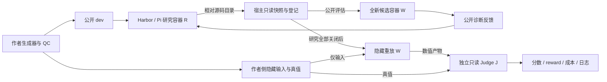

# SciResearch-Bench-Lite：科学计算自主研究基准最终实验报告

**提交仓库：<https://github.com/bxf1/sciresearch-bench-lite>**
2026-10-24，Asia/Shanghai。研究领域：科学计算。

本项目实现了三条可运行、可自动评分的科研任务：热方程初场恢复、稀疏动力学辨识、稀疏线性系统求解优化。完成 90 个合成实例的数据生成和 QC、全部 11 种作者基线、15 次独立 Agent 研究及其隐藏评价操作。原正式批次中，9 次研究有提交、6 次正常无提交；14/15 有有效评分，其中包含无提交的零分；Poisson G2 因宿主计时干扰留空。因此不能把“有效评分率”解释为“成功率”。

**最终科学结论来自原正式批次：6 次 reward=1、8 次有效未成功、1 次计时无效。** 三个任务均完成作者基线与端到端 Agent 验证，但小样本不足以证明指导组优劣。可比较的 8 次研究中，2 次改进、1 次退化、5 次未改变源码，表明可观察到迭代收益，也存在反例。

本报告按作业的五项核心任务组织，以已完成的 formal-003 实验为主要证据。完整数据目录见[数据交付索引](../data/README.md)，关键执行片段见[日志与证据链](evidence.md)，复现步骤见[复现指南](reproduction.md)。另行取消的选择性补跑不进入本报告的科学分母，具体记录放在[补充附录](supplemental-results-2026-10-24.md)。

## 1. 调研结论与问题选择

详细论文、源码路径、比较表和两套逻辑框图见[基准调研](survey.md)。ASI-Bench 通过同一研究项目下撤除方法指导衡量自主执行；Terminal-Bench-Science 通过领域专家工作流、可信产物测试和任务质量维护闭环衡量科学实践。前者启发指导组控制，后者启发环境验收、客观判题、Oracle/Nop 与失败归因。

科学计算适合小规模可复现实现：生成规则明确、数值真值可独立计算、强弱基线可解释、成本可承受。三条任务分别检验病态逆问题的稳定化、噪声动力学的结构识别、正确性约束下的计算效率。它们覆盖方法选择、实现、实验反馈与修订，但不衡量文献新颖性、实验室实物操作或原创科学发现。

## 2. 数据生成、清洗与质量控制

每任务 30 例：6 public-dev、12 author-calibration、12 final-test；每档难度分别 2/4/4 例，共 90 例。根熵结合 task/split/level/case/component 的命名空间，通过 SHA256、SeedSequence 与 PCG64 生成独立随机流。数据来源是数学模型，不是抓取外部实测数据。所谓“清洗”是有限性、shape、合法参数、重复实例、数值真值及文件一致性检查，不按求解器得分筛掉难样本。

| 任务 | 生成过程 | 独立 QC | 难度因素 |
|---|---|---|---|
| Heat | 32 个正弦模态构成初场，热半群产生观测；缺测和独立高斯噪声 | t=0/半群/边界、PDE 模态残差及独立 DST 传播 | 观测更晚、高频衰减、缺测和噪声增加 |
| ODE | 二维三阶多项式动力学，DOP853 生成多初值轨迹，按通道幅度加噪 | 解析 RHS 与系数库、Radau 交叉积分、能量关系、rank/条件数 | 噪声放大导数误差、模型稀疏性与长时外推 |
| Poisson | 正系数离散扩散算子、调和平均边权、四列制造解，B=A U* | 对称/符号/SPD、小尺寸独立模板、独立通量复算和舍入界 | n=32/64/128、系数对比度 1/30/300、重复 RHS 的复用 |

每例保留输入、真值、噪声及中间量、潜变量指纹和 QC；每个文件绑定 SHA256。Poisson 易档可复用固定算子，但 RHS 独立；这不增加独立研究样本数。详细分布、公式和输出约定见[任务卡](task_cards.md)、[Heat](heat.md)、[ODE](ode.md)、[Poisson](poisson.md)以及 `authoring/` 源码。

仓库直接包含三任务共 18 个 dev 实例。完整 90 例输入、参考真值、QC 与生成记录作为 Release 的 `author-data-v0.3.tar.gz` 发布，并提供[逐例索引](../data/case-index.csv)及[1,364 个文件的哈希清单](../data/file-manifest.json)。按 9 个 task/split 重新核对，90/90 例 QC 通过，难度数量分别符合 2/4/4 例每档；原公开输入与 Release 对应文件逐字节一致。数据发布与执行时隔离是不同要求：复现者可拥有作者数据，但运行 Agent 时必须继续使用受控入口，不能把整个仓库挂入研究容器。

## 3. 任务输入、工具、产物与成功条件

所有任务的候选入口为 `python solve.py --input /input --output /output --seed 0`。Agent 可在研究环境编写文件、运行命令和调用公开评估桥；只能访问共同 public-dev 数据。提交的是相对源码目录，宿主生成只读快照并登记 ID；final 必须引用已登记候选。

| 任务 | 输入 | 产物 | 科学成功条件 |
|---|---|---|---|
| Heat | x/t/y 观测、κ 等元信息、256 点目标网格 | 各例 float64 `u0.npy` | 初场相对误差 ≤0.15 且未来场误差 ≤0.03；12 例全部通过才 reward=1 |
| ODE | 6 训练和 2 公开验证轨迹、时间网格、精确初值 | `(10,2)` 系数矩阵的 `model.json` | 系数阈值化后 K≤10；4 条隐藏长轨迹最大误差及隐藏向量场误差均 ≤0.05；12 例通过 |
| Poisson | CSR A、四个 RHS、元信息 | `(n*n,4)` float64 `solution.npy` | 每列残差 ≤1e-8、解误差 ≤1e-5，资源合格；冻结效率 profile 另要求全批 speedup≥1.5 |

G1 提供详细方法，G2 提供方法方向，G3 只给共同契约。组间数据、产物、工具与科学阈值一致；本项目 G2 不给具体算法名称，不是 ASI-Bench B2 的完全复刻。

## 4. 环境、独立自动评分与隐藏隔离



R 配置 4 vCPU/4 GiB，使用原生 Harbor Pi；W 配置 1 vCPU/4 GiB、数值线程 1、无网络、禁 swap。W 不挂载真值和 Judge 代码。J 读取数值产物进行形状、有限性和数学核验，不执行候选源码。研究容器仅访问专用模型代理；代理持有供应商凭据，R 只接收短期会话令牌。可信登记和快照放在 R 之外。

Heat 连续分按初场/未来场 0.8/0.2 加权，误差截断尺度为 0.30/0.06；ODE 结合隐藏轨迹与向量场误差及模型约束；Poisson 在正确性与环境合格后报告完整批次耗时和 speedup。令 c(x)=min(1,max(0,x))：Heat 为 100[0.8c(1−E初场/0.30)+0.2c(1−E未来/0.06)]；ODE 为 100[0.5c(1−E轨迹/0.10)+0.5c(1−E向量场/0.10)]，产物、积分或稀疏约束失败按规则归零；Poisson 在有效正确计时后为 100c(log(speedup)/log(8))，speedup 是三次基线耗时中位数除以三次候选耗时中位数。score 与全例通过的二值 reward 分开。具体边界由 `judge/`、`runner/phase.py` 与冻结文件定义，不用语言模型替代数值判题。

Heat/ODE 各候选独立重放三次；Poisson 采用 B,C,C,B,B,C 交错次序，每次用新容器，包含启动、Python 导入、I/O、矩阵转换、分解和四个 RHS 求解。固定比较器是公开 Jacobi-CG，正式速度与程序自报内部耗时分开。共享源码的 first/final 可复用同一结果，不能算作两次独立研究。

运行失败、数值不正确与评估环境无效分别记录。正常无提交可按协议记零；API、控制器或评分器故障保留为无效 attempt；不合格计时的 score/reward/speedup 保持 null，不能补零或挑一次最好速度。

## 5. 全部任务基线检查

11 种作者方法均已运行，固定参考在研究之前选择。以下为 formal-003 隐藏重放结果，非调参后挑选的最佳值；原始结果及逐例记录见[正式报告](formal-results-2026-10-23.md)。

| 任务 | 方法 | 分数 | 正确例/12 | reward | speedup |
|---|---|---:|---:|---:|---:|
| Heat | 未正则化 LS | 19.556 | 0 | 0 | — |
| Heat | rank5 | 89.893 | 12 | 1 | — |
| Heat | Tikhonov（固定参考） | 93.271 | 12 | 1 | — |
| Heat | discrepancy | 91.651 | 12 | 1 | — |
| Heat | TSVD | 92.192 | 12 | 1 | — |
| ODE | 原始差分 | 0.000 | 0 | 0 | — |
| ODE | SG/STLSQ fixed（固定参考） | 95.389 | 12 | 1 | — |
| ODE | 公开验证 search | 95.647 | 12 | 1 | — |
| Poisson | CG | 0.000 | 12 | 0 | 0.199 |
| Poisson | Jacobi-CG | 0.014 | 12 | 0 | 1.000 |
| Poisson | LU 复用（固定参考） | 38.976 | 12 | 1 | 2.249 |

这些检查支持三种不同难度来源：Heat 不能只拟合观测，需要稳定正则化；ODE 不能直接对噪声做差分，需要结构和去噪；Poisson 数值正确不代表高效，重复 RHS 使分解复用有价值。弱方法正常失败是基准有区分度的证据之一，但这些少量方法不能证明任务对所有 Agent 都有同样难度。

### 5.1 分难度复核与解释

以下由既有逐例结果重新汇总，不增加实验。每档只有 4 个不同 final-test 实例，每例 3 次独立重放；先对重复取中位数，再对 4 例取均值，不能把 12 次执行算成 12 个独立样本。[全部 33 行分难度表](../results/delivery-analysis/baseline-by-difficulty.csv)保留每种作者方法。

| 固定参考 | 易档均分 | 中档均分 | 难档均分 | 各档三次均通过的实例 |
|---|---:|---:|---:|---|
| Heat Tikhonov | 93.622 | 95.195 | 90.997 | 4/4、4/4、4/4 |
| ODE SG/STLSQ fixed | 98.934 | 96.744 | 90.490 | 4/4、4/4、4/4 |
| Poisson LU | 不按单例定义效率分 | 不按单例定义效率分 | 不按单例定义效率分 | 数值正确性均 4/4 |

ODE 固定参考的均分随噪声档位下降，符合导数估计更敏感的机制；Heat 中档高于易档，说明少量随机实例的得分未必严格单调，不能将“难度标签”当成经过大样本验证的排名。Heat 的未正则化 LS 和 ODE 原始差分在三个档位均为 0/4 科学通过，而各自强方法均通过，支持任务对方法选择的区分。Poisson 三种方法的 12 例均数值正确，差异主要出现在完整批次效率：CG 0.199×、Jacobi-CG 约 1×、LU 2.249×；因此其效率门槛不能由逐例正确率替代。

## 6. 端到端 Agent 结果与迭代

formal-003 使用 DeepSeek-V4.1-Flash-1017 的 `deepseek-flash` 路由、temperature=0、top_p=1、thinking disabled。每请求最多 4,096 输出 token，每会话累计 200,000，30 分钟、20 次公开评估；原生上下文压缩计入预算。15 次研究中 Heat 每组 3 次，ODE/Poisson 每组各 1 次。供应商路由名与不可观察的底层模型修订不能等同。

| 任务/组 | 有效评分/计划 | final 中位分 | reward=1 数 |
|---|---:|---:|---:|
| Heat G1 | 3/3 | 0.000 | 1 |
| Heat G2 | 3/3 | 19.553 | 0 |
| Heat G3 | 3/3 | 0.000 | 1 |
| ODE G1 | 1/1 | 96.551 | 1 |
| ODE G2 | 1/1 | 98.793 | 1 |
| ODE G3 | 1/1 | 99.068 | 1 |
| Poisson G1 | 1/1 | 44.308 | 1 |
| Poisson G2 | 0/1 | null | null |
| Poisson G3 | 1/1 | 0.000 | 0 |

全部 15 次正式研究的明细如下；`—` 表示缺失或无效，不等于零。正常无提交的 final 零分来自原协议；Poisson G2 无效计时留空。

| 会话 | first 分 | final 分 | final 通过数 / 12 | reward | 结果 |
|---|---|---|---|---|---|
| heat G2 r1 | 93.791 | 87.210 | 11 | 0 | 已重放 |
| heat G3 r1 | 21.394 | 91.532 | 12 | 1 | 已重放 |
| heat G1 r1 | 93.631 | 93.631 | 12 | 1 | 已重放 |
| ode G1 r1 | 96.551 | 96.551 | 12 | 1 | 已重放 |
| ode G2 r1 | 98.793 | 98.793 | 12 | 1 | 已重放 |
| ode G3 r1 | 99.068 | 99.068 | 12 | 1 | 已重放 |
| poisson G3 r1 | — | 0.000 | 0 | 0 | 无有效提交 |
| poisson G2 r1 | — | — | — | — | 计时无效，留空 |
| poisson G1 r1 | 37.096 | 44.308 | 12 | 1 | 已重放 |
| heat G3 r2 | — | 0.000 | 0 | 0 | 无有效提交 |
| heat G1 r2 | — | 0.000 | 0 | 0 | 无有效提交 |
| heat G2 r2 | 19.553 | 19.553 | 0 | 0 | 已重放 |
| heat G3 r3 | — | 0.000 | 0 | 0 | 无有效提交 |
| heat G1 r3 | — | 0.000 | 0 | 0 | 无有效提交 |
| heat G2 r3 | — | 0.000 | 0 | 0 | 无有效提交 |

Heat G3 r1 是完整端到端例子：公开研究产生首次与最终候选，宿主快照冻结后在同一隐藏集重放，分数从 21.394 升至 91.532，通过数从 0/12 升至 12/12。Poisson G1 从 37.096 升至 44.308，速度从 2.163× 到 2.513×。反例 Heat G2 r1 从 93.791 降为 87.210、通过数从 12 降为 11，保留退化结果。

### 6.1 端到端证据：Heat G3 r1

这条会话展示“Agent 编程和实验 → 公开工具反馈 → 可信登记 → 研究关闭 → 独立隐藏评分”的完整链条。原生宿主事件在关闭 registry 时保留以下字段节选（完整行与文件 SHA256 见[日志证据](evidence.md)）：

```json
{
  "kind": "registry_closed",
  "fields": {
    "attempt_status": "completed",
    "final_id": "candidate-018",
    "first_id": "candidate-017"
  }
}
```

独立评分记录中的 `diagnostics.first` 为 `candidate-017`，`replay_count=3`、`score=21.394330950607056`、`reward=0`；`diagnostics.final` 为 `candidate-018`，`replay_count=3`、`score=91.53191716630722`、`reward=1`。两个源码哈希不同，验证了产物确实修订。最终结果不是 Agent 自报分数；三次重放分别对同一冻结的 12 例判断。原始文件：[研究关闭事件](../research-runs/research-6615cd7900ba0750-heat-g3-r1/host-events.jsonl)、[独立评分结果](../research-runs/research-6615cd7900ba0750/final-replays/research-6615cd7900ba0750-heat-g3-r1-a001/result.json)。

进一步对照两个候选源码，唯一差异是正则化参数默认值从 `lam=1e-4` 改为 `lam=0.1`，其余 32 模态、观测矩阵和输出路径不变（[完整逐行 diff](../results/delivery-analysis/heat-g3-source.diff)）。求解器解的是 `(AᵀA+λI)c=Aᵀy`。例如公开例 `13a841e7b6de490e68f4`，归一化观测残差 R 从 0.90585 升至 0.98150，而 roughness 从 2774.714 降至 44.839；两个公开反馈均确认产物合法，且不包含隐藏初场误差。原始反馈片段见[日志证据](evidence.md)。

这与病态逆问题中“增加正则化、容许稍大的观测残差、抑制不稳定高频”的机制一致；最终隐藏误差与通过数验证了这次修改的效果。它也说明单纯最小化公开观测残差并不等于恢复真实初场。这里是既有代码和反馈的事后解释，不能据此补写 Agent 未记录的假设，也不证明所有数据上更大的 λ 都更好。

8 个有候选且可比较的会话中，2 个提升、1 个退化、5 个源码不变；6 个无提交及 1 个计时无效不能判断迭代变化。first→final 是同会话观测，不是反馈因果试验。各指导组样本太小，不能宣称某组稳定更优；三任务分数也不直接跨任务平均。

15 次有效研究累计已知输出 2,324,341 token；连同 4 个无效 attempt，已知输出 2,591,496，代理 charged 为 2,613,274。差额是失败请求的保守额度，真实用量未知，不是实测账单。有效研究墙钟合计约 5.276 小时；请求、候选 CPU 和隐藏 CPU 等详见原报告。不能把输出 token 当作总输入或货币费用。

## 7. 失败模式与评测可靠性

| 观察 | 归因证据 | 应如何解释 |
|---|---|---|
| 长段重复工具调用 | 原始参数和返回哈希相同 | 预算用于重复计算；不推断模型内部心理状态 |
| 仅文件名递增 | Heat G1 r2 的 515 次调用规范化后相同 | 逐字去重会高估独立探索次数 |
| 持续新模拟但不提交 | Heat G1 r3 的 220 个种子、不同结果 | 与无变化重复区分；研究到产物提交环节失败 |
| 源码导出失败 | 62 次公开评估中 24 次导出失败；点路径、绝对路径、文件路径等 | 接口反馈仅给 empty tar，不能全当作数学能力不足 |
| API/用量/宿主故障 | 独立 attempt、事件日志和保守计费 | 不进入科学分母，仍报告成本 |
| Poisson G2 计时干扰 | 宿主 VPN CPU 峰值超过预定门槛 | 数值通过不赋予正式性能结论；原计时保留 |
| 本次聊天中断 | 宿主控制器退出而研究容器继续调用 | 已保留无效 attempt、清理遗留资源并采用关联恢复；不是科学零分 |

已完成的可信验证包括：独立 GT/QC、产物 schema 与恶意路径测试、错误模型与弱基线、环境边界与资源检查、冻结文件哈希、重复重放和连续宿主计时观察。第三版冻结时 357 项测试通过；token-only 支持新增后 360 项通过。测试通过只覆盖已测行为，不能作为完美安全隔离或数学实现永远正确的证明。

原冻结测试日志末行为 `357 passed, 2 warnings in 14.07s`。资源验收、研究停止、registry 关闭、三次隐藏重放、Poisson G2 拒绝窗口和全局 93 个 worker 批次均有原始记录，集中节选在[日志与证据链](evidence.md)。本次交付整理只重新汇总表格并验证文件一致性，没有调用模型或重跑候选，不能把交付审计当作新增科学重放。

## 8. 已取消补跑：范围、重复循环与解释边界

补跑原计划仅覆盖 Poisson G3 r1、Heat G3 r2/r3、Heat G1 r2/r3、Heat G2 r3，每会话 500,000 输出 token，无研究总墙钟、累计请求或累计评估次数上限；另计划重放原 Poisson G2 候选。科学阈值、输入、方法提示、单请求输出和候选资源未优化。现已按用户要求停止整个补充队列，没有新增有效科学成绩。

最新 Poisson G3 的 652 次 API 请求全部成功，但原生日志中 648 次工具调用仅有 66 种精确参数组合。三个重复诊断命令分别执行 424、107、53 次；最长连续相同调用为 236 次，末尾连续重复 107 次。各重复块的返回内容相同且无工具错误；调用 ID 唯一，排除了重复统计同一条日志。模型曾写入 `solve.py`，但从未调用 `bench evaluate` 或 `bench finalize`。这支持“工具调用陷入重复且未转入提交”的观察，不支持模型或供应商内部原因的因果结论；HTTP 200 只证明请求成功，不代表研究有进展。完整规则和行号见[原生日志审计](../logs/supplemental-2026-10-24/repetition-audit-final.json)。

该尝试在预算耗尽前被用户终止，不能标记为正常完成 50 万 token 实验；未启动的五项也不能计入失败率。选择性补跑本就不是独立等预算比较，现又提前终止，因此不能据此估计 50 万相对 20 万 token 的因果收益。既有正式实验的所有分数、分母和成本保持原记录。

## 9. 局限与扩展

1. 三类合成任务、一个模型路由、一个宿主且组内样本少，外部有效性有限。下一步加入真实带噪实验数据及不同生成族的全新隐藏集。
2. 原提交接口的目录约束和错误反馈不清楚，影响有效提交率。本轮按要求保留，未来新版本单独修复并预注册接口消融。
3. 公开代理指标不等价于隐藏科学指标，存在公开验证过拟合；应比较公开最优、显式 final 与预声明选择规则。
4. 时间、token、CPU 与货币成本不是同一种预算。未来做等 token/等时间配对试验，并记录全部失败开销。
5. Poisson 的短任务速度受环境影响，需跨机器重复、观察窗口、稳定性阈值和更大工作负载。
6. 当前改进对象是任务求解器。真正的 RSI 扩展需允许 Agent 改自身策略/工具代码，冻结新版本，并在未见任务上评估迁移；同时禁止读取评分器或训练于隐藏答案。

## 10. 可复现交付与验收映射

| 作业要求 | 交付位置 |
|---|---|
| 1. Benchmark 调研、论文与源码、逻辑框图 | [survey.md](survey.md) 与 `.archify/` 两张带源码引用的 HTML |
| 2. 选择一个领域 | 科学计算；本报告第 1 节与三条数学任务 |
| 3. 至少 3 条完整任务及数据 | `tasks/{heat,ode,poisson}/`、[task_cards.md](task_cards.md)、[90 例数据索引](../data/README.md)、`authoring/` |
| 环境配置与基线 | `environment/`、`freezes/host-requirements.lock`、`baselines/` |
| 4. 自动独立评分与隐藏隔离 | `judge/`、`runner/`、[protocol.md](protocol.md) |
| 5. 全任务基线与端到端结果 | 本报告第 5–7 节、[日志节选](evidence.md)、[formal-results](formal-results-2026-10-23.md)、`results/formal-study-003/` |
| 失败模式、难度、可靠性与扩展 | 本报告第 5–9 节、[提交诊断](submission-diagnosis-2026-10-23.md) |
| 补跑取消、重复循环与清理证据 | [补充实验](supplemental-results-2026-10-24.md) |
| 安装、复现与证据入口 | 仓库 [README](../README.md)、[复现指南](reproduction.md)、`python3 tools/verify_delivery.py` |

历史报告中的“尚未冻结”“不再重试”“未推送”是当时记录，不是 2026-10-24 新授权后的当前状态。以本报告、补充实验状态和当前 README 为交付入口，原始证据不覆盖。
