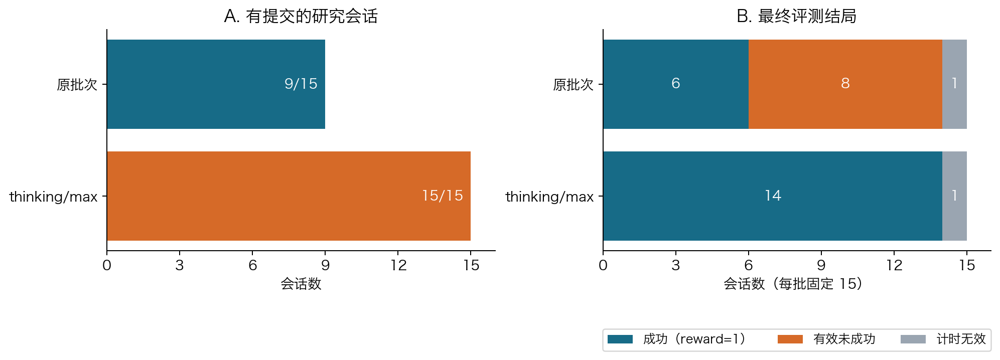
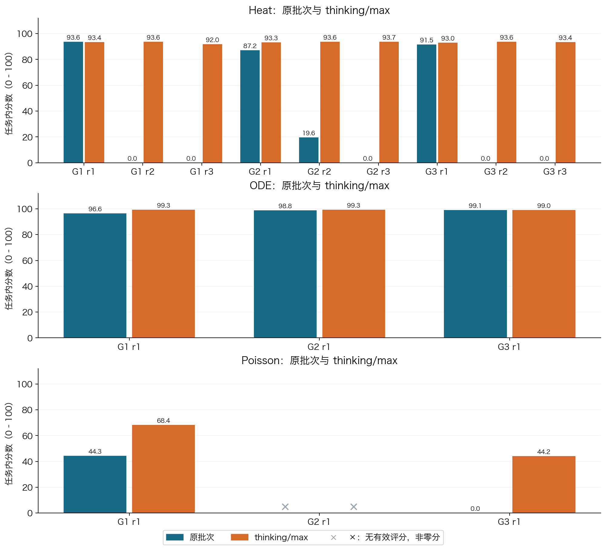
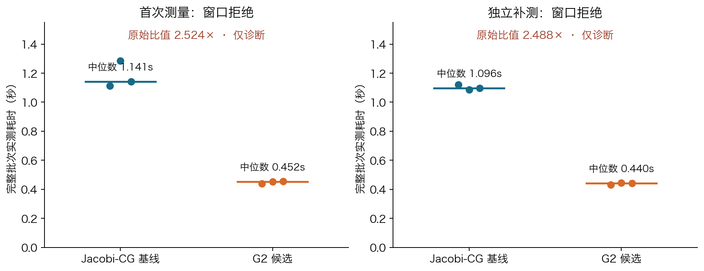

# SciResearch-Bench-Lite：科学计算自主研究基准设计与实验报告

**课程作业最终报告 · 2026 年 10 月 25 日**<br>
研究领域：科学计算；提交形式：个人 GitHub 仓库。<br>
**[提交仓库](https://github.com/bxf1/sciresearch-bench-lite)** · [阅读打印版 PDF](../output/pdf/sciresearch-final-report-20261025.pdf) · [离线阅读版 HTML](submission-report-2026-10-24.html) · [完整材料与 Release](https://github.com/bxf1/sciresearch-bench-lite/releases/tag/v0.3-submission-20261024)

## 摘要与阅读说明

本项目关心一个具体问题：**AI 能否在有限时间和工具预算内，把科研任务转化为可运行的方法，并利用实验反馈改进结果？** 为此，在科学计算领域实现了三条任务：从温度观测恢复初始温度分布（Heat）、从带噪运动轨迹识别动力学方程（ODE）、在保证解正确的前提下加快稀疏方程求解（Poisson）。三条任务共生成 90 个合成实例，配置了 11 种作者基线，并由独立程序验证候选代码的输出。

实验包括两个分别统计的批次：原批次关闭 thinking；对照批次启用 thinking，并把 effort 设为 max。每批均包含 15 个研究会话，每会话最多 20 万输出 token、30 分钟和 20 次公开评估。原批次 9/15 有提交、6/15 达到成功条件；对照批次 15/15 有提交、14/15 取得有效且成功的最终成绩。剩余 Poisson G2 已通过数值检查，但正式计时窗口不合格，正式分数留空；其独立补测的原始耗时比为 **2.488×，仅作诊断**。

这些结果说明，本项目已形成“任务—数据—Agent 实验—可信提交—独立评分—日志分析”的可运行闭环。对照条件下提交率和多数任务成绩提高，但中途执行器修复、重复使用同一隐藏集、先后运行及小样本等因素，使我们不能把差异单独归因于 thinking，也不能据此宣称实现了真正的递归自我改进。

**读表约定：** 分数保留三位小数；`0` 是按规则得到的零分，`—` 是没有有效成绩，两者不同。`reward=1` 表示满足该任务全部成功条件，`reward=0` 表示有效评测下未成功。主表按 **Heat → ODE → Poisson、G1 → G2 → G3、r1 → r2 → r3** 排列，实际执行序号另列。完整精度和来源哈希见[整理后的数据](../results/final-report-2026-10-25/analysis.json)。

## 1. 背景与研究目标

普通问答往往只检查最终答案；科研工作还要求选择方法、实现代码、设计实验、识别失败并修改方案。一个程序能运行，不一定得到了正确科学结果；一次公开测试表现好，也不一定能推广到新的测试样本。因此，Auto Research Benchmark 需要同时评价研究过程与最终产物。

本报告采用以下工作定义：Auto Research 指让 Agent 自主完成方法选择、实验和改进；AI Scientist 的范围可以进一步包括提出想法、文献分析、写作与评审；Research Agent 是执行这些工作流的工具使用系统。RSI（Recursive Self-Improvement，递归自我改进）则要求系统修改自身的策略、工具或代码，并验证改进能作用于后续任务。**本项目测量的是 Agent 对当前求解器的研究与改进，没有把模型或 Agent 自身作为优化对象。**

选择科学计算有三个原因：第一，热方程、常微分方程和线性系统都有明确数学结构；第二，可以生成数据并独立构造参考真值；第三，任务规模适合个人机器运行。代价是实验主要代表受控合成问题，不能直接外推到实验室发现或开放世界科研。

项目围绕四个问题组织：

1. 三条任务是否具有完整的数据、环境、基线和独立自动评分？
2. 给予不同强度的方法指导后，Agent 能否形成有效提交？
3. 同一会话首次与最终候选相比，是否出现可核验的改进或退化？
4. 启用 thinking/max 的匹配对照，在提交、结果和输出用量上呈现什么差异？

第 4 项是在看到原结果后追加的探索性对照；后文“是否符合预期”的讨论是依据任务机制的事后分析，不冒充预注册的统计假设检验。

## 2. 相关工作调研与设计借鉴

下表比较了六项相关工作。前四项依据论文，后两项同时依据本地固定版本的官方源码。详细源码位置、工作流图与版本说明见[调研文档](survey.md)。

| 工作 | 任务、环境与工具 | 评价方式 | 本项目借鉴及局限 |
|---|---|---|---|
| [AI Scientist-v2](https://arxiv.org/abs/2504.08066) | 提出假设，管理机器学习实验，执行代码并撰写论文；使用实验管理与树搜索 | 实验指标、图文检查和论文评审 | 借鉴“假设—实验—分析—修订”；论文质量与数值正确性不能用同一指标概括 |
| [ScienceAgentBench](https://arxiv.org/abs/2410.05080) | 从科研论文抽取数据分析任务，要求生成可执行 Python 程序 | 检查程序、运行产物与成本 | 借鉴可执行产物验收；完成指定分析不等于提出原创科学理论 |
| [MLGym](https://arxiv.org/abs/2502.14499) | 可执行的机器学习研究环境，支持方法实现、训练、实验及反馈迭代 | 任务性能指标及实验轨迹 | 借鉴公开反馈驱动的迭代；跨任务指标与计算预算需要分别校准 |
| [Darwin Gödel Machine](https://arxiv.org/abs/2505.22954) | 修改 Agent 自身代码，并保留不同后继版本 | 使用编程基准实测改动效果 | 帮助界定 RSI；编程能力提升不能自动等同于科学研究能力提升 |
| [ASI-Bench](https://github.com/apexin-ai/ASI-Bench/tree/b100adef1acef9e38cc2cea298f2d07a8cc1fd84) | 在同一科研项目中改变方法指导信息，Agent 选择方法并调用工具 | 产物合法性门槛、任务评分、运行与评价状态 | 借鉴匹配的信息条件；本项目 G2 只给方向，不完全复刻其 B2 方法提示 |
| [Terminal-Bench-Science](https://github.com/harbor-framework/terminal-bench-science/tree/de562a2863f372795d7dd09ff28876f779b3aa33) | 专家设计的终端科研工作流；任务包包含指令、环境、测试和参考解 | 独立任务测试，并通过参考解、空操作和对抗检查维护质量 | 借鉴任务包、隔离执行和客观验收；真实任务的依赖维护与专家制作成本较高 |

两项主要参考各解决了一类问题：ASI-Bench 启发我们在保持任务目标和评分一致时，改变给 Agent 的方法指导；Terminal-Bench-Science 启发我们把题目做成真正可运行、可测试、可复查的任务包。本项目将两者结合，用三种指导强度研究同一数值任务，并将结果交给独立判题程序。

现有工作的共同挑战包括：任务和环境差异会干扰模型比较，最终分数难以解释过程失败，公开反馈可能被过拟合，以及真实科研的新颖性很难完全自动评分。本项目通过统一接口、固定预算、隐藏测试和细分失败状态降低这些问题，但并未解决全部开放科研评价难题。

## 3. Benchmark 任务与数据构建

### 3.1 三条任务分别考察什么

| 任务 | 通俗解释与研究难点 | 输入 | 必须提交的产物 |
|---|---|---|---|
| T1 / Heat：热方程初场恢复 | 热量扩散会抹平细节；根据较晚、带噪、缺失的温度观测推回最初分布，需要防止噪声被放大 | 时空温度观测、扩散系数、256 点目标网格 | 每例一个 `u0.npy` 初场数组 |
| T2 / ODE：稀疏动力学辨识 | 从多个初始状态的带噪轨迹中找出运动方程；既要拟合观测，又要用少量项预测新轨迹 | 6 条训练轨迹、2 条公开验证轨迹、时间和精确初值 | 一个 `(10,2)` 多项式系数矩阵 `model.json` |
| T3 / Poisson：稀疏求解优化 | 求解 `A U = B`；矩阵很大但多数元素为零，四个右端项可共享计算，要求既正确又快 | 稀疏矩阵 `A.npz`、四列右端项 `rhs.npy` | 每例一个 `(n*n,4)` 的 `solution.npy` |

三条任务使用统一候选入口：`python solve.py --input /input --output /output --seed 0`。Agent 可以读写研究工作区、调用终端、编写和运行 Python、进行局部试验并调用公开评估工具。它提交相对源码目录，由宿主复制为只读候选快照；最终提交必须引用已登记候选，不能由 Agent 自报一个分数代替程序产物。

### 3.2 数据来源、划分与清洗

数据来自明确的数学模型，属于**合成数据**，不是外部实测数据采集。每条任务生成 30 例，共 90 例；每份数据固定后，两批实验使用相同划分。

| 划分 | 每任务数量 | 三任务合计 | 易 / 中 / 难数量（每任务） | 用途和可见范围 |
|---|---:|---:|---|---|
| public-dev | 6 | 18 | 2 / 2 / 2 | Agent 研究时可见，获得有限的公开诊断反馈 |
| author-calibration | 12 | 36 | 4 / 4 / 4 | 作者基线和评测规则验收，研究 Agent 不可见 |
| final-test | 12 | 36 | 4 / 4 / 4 | 研究关闭后的独立最终评价，研究 Agent 不可见 |
| 合计 | 30 | 90 | 10 / 10 / 10 | 三种角色的数据彼此分开 |

Heat 用 32 个正弦模态构造初场，按热方程产生后续观测，再加入缺测和高斯噪声；难度随观测延迟、缺失和噪声改变。ODE 生成二维三阶多项式系统的多初值轨迹，并按通道幅度加噪；难点在于噪声导数、稀疏结构及长时预测。Poisson 构造正系数离散扩散矩阵及四列制造解，设 `B=A U*`；三个档位使用网格边长 32/64/128 和系数对比度 1/30/300。

“清洗”在这里指生成后的质量检查（QC）：数值是否有限、形状与参数是否合法、是否出现非预期重复、真值能否被独立方法交叉验证、文件是否完整。Heat 用独立传播方式和方程残差核对；ODE 用另一种积分器交叉核对；Poisson 检查矩阵性质及独立通量复算。**90/90 例通过 QC；没有根据 Agent 得分删掉困难样本。** 随机流由命名空间和根熵派生，文件保留 SHA256 以检查一致性。

仓库包含 18 例公开输入；完整 90 例输入、作者真值、QC 和生成记录在 Release 的 `author-data-v0.3.tar.gz`。详见[数据索引](../data/README.md)、[任务卡](task_cards.md)与[逐文件清单](../data/file-manifest.json)。完整作者数据发布用于复核，但未来研究运行仍必须隔离真值；公开后的旧隐藏集不能继续被宣称为全新盲测集。

## 4. 实验设计与编号说明

### 4.1 G1、G2、G3 是指导强度

| 编号 | 提供给 Agent 的信息 | 本项目想观察的能力 |
|---|---|---|
| G1 | 共同任务契约，加详细方法指导 | 能否把较明确的方法实现并完成实验 |
| G2 | 共同任务契约，加研究方向；不提供具体算法名 | 能否从方向构建具体可行方案 |
| G3 | 共同任务契约：目标、输入、工具、产物和约束 | 能否自主选择方法并验证结果 |

组别改变的是方法提示；输入、工具、预算、输出格式和科学成功条件保持一致。G3 仍有完整任务说明，并非没有任何信息。

### 4.2 r1、r2、r3 是什么

**r 是 repeat（重复运行）的缩写。** 例如，`Heat G2 r3` 表示“热方程任务、G2 方向指导组、第 3 次独立研究会话”。每次从新的研究工作区开始，不继承同组上一次的候选。重复运行用于观察同一条件下表现是否稳定。

必须区分以下三种“重复”：

| 标记或操作 | 含义 | 是否增加独立研究样本 |
|---|---|---|
| r1 / r2 / r3 | 同一任务和指导组的第 1 / 2 / 3 个研究会话 | 是；但仍共享任务数据、模型和宿主条件，不代表独立数据集 |
| a001 / a002 | 同一研究会话的执行尝试；a002 是明确关联的基础设施恢复重试 | 否；失败记录与开销另存，不把两次尝试算成两个科学样本 |
| 同一候选评分重放三次 | 提交后的程序在隔离环境重复执行，核对数值和运行表现 | 否；重复使用同一组 12 个测试实例，不变成 36 个独立测试例 |

`r2` 不是中等难度，`r3` 不是最终改进版，也不代表换了隐藏测试集。本轮求解器种子固定为 0；研究会话独立启动并不意味着拥有三个不同的数学数据种子。`first` 是可信登记中确定的首次候选，`final` 是会话最终指定候选；final 不是事后挑选隐藏成绩最高的版本。

### 4.3 为什么每批是 15 个会话

| 任务 | G1 | G2 | G3 | 每批会话数 |
|---|---|---|---|---:|
| Heat | r1、r2、r3 | r1、r2、r3 | r1、r2、r3 | 9 |
| ODE | r1 | r1 | r1 | 3 |
| Poisson | r1 | r1 | r1 | 3 |
| 合计 | | | | 15 |

这是小规模、非均匀重复的设计：只对 Heat 每组重复三次，ODE 和 Poisson 每组只有一次，不能据此比较稳定的组间优劣。原批次与对照批次按同一个“任务 × 指导组 × repeat”格子配对；两个批次分别分析，不合并成 30 次同条件样本。

### 4.4 模型、预算与对照条件

| 条件 | 原正式批次 formal-003 | thinking/max 对照 |
|---|---|---|
| 研究框架 | Harbor / 原生 Pi | 相同框架；执行期间发生三次基础设施修复，见第 9 节 |
| 模型路由 | `deepseek-flash`；冻结时记录为 DeepSeek-V4.1-Flash-1017 | 相同记录的路由；不能独立锁定供应商内部修订 |
| thinking | disabled | enabled |
| effort | 未设置 | max |
| temperature / top_p | 0 / 1 | temperature 不生效，记录 null；top_p=1 |
| 单请求输出上限 | 4,096 token | 4,096 token |
| 每会话累计输出上限 | 200,000 token | 200,000 token，包含 thinking、普通输出及原生压缩 |
| 每会话其他上限 | 1,800 秒；20 次公开评估 | 相同；任一预算先到则停止 |
| 数据、提示、评分与研究资源 | 冻结 | 保持原科学参数 |

两批冻结计划见[原计划](../freezes/research-run-plan-formal-003.json)和[对照计划](../freezes/research-run-plan-thinking-max-2026-10-25.json)。对照为事后追加，thinking 和 max 共同改变，temperature 语义也不同，且先后执行、中途修复，因此不是隔离单一变量的严格因果实验。此前选择性扩大到 50 万 token 的补跑已取消，其记录保留在[补充附录](supplemental-results-2026-10-24.md)，不进入这里的 15 格比较。

## 5. 运行环境、评测规则与隔离

### 5.1 从研究到评分的执行流程

1. **生成并冻结数据**：作者构造输入、参考真值和 QC，分开公开与隐藏部分。
2. **Agent 开展研究**：研究容器只能读取公开数据，编写候选并获得公开反馈。
3. **可信提交登记**：宿主对源码生成只读快照，记录候选 ID 与哈希。
4. **关闭研究**：本批全部研究关闭后，才开放最终隐藏评分；评分结果不会回灌仍在进行的研究。
5. **独立执行与判题**：全新 W 容器运行候选；J 容器读取数值产物及真值完成判断。
6. **保留全链证据**：记录分数、成功标记、资源与用量、候选版本、错误及原始日志。

实际环境为 M4 MacBook Air 上的 Colima Linux aarch64。研究容器 R 为 4 vCPU / 4 GiB；候选容器 W 为 1 vCPU / 4 GiB、单数值线程、无网络且禁 swap。数值环境固定 Python 3.12.12、NumPy 2.2.6 和 SciPy 1.15.3，镜像与源码哈希均留档。W 不接触真值和 Judge 代码；J 不运行候选源码，只检查产物。模型凭据由研究容器外的 relay 管理。

这一区分很关键：Agent 可以声称“已经正确”，但最终成绩来自独立程序对文件的检查。详见[隔离协议](protocol.md)和[复现指南](reproduction.md)。

### 5.2 正确性、研究效果、效率与可复现性

| 维度 | 本项目如何测量 | 读数含义 |
|---|---|---|
| 正确性 | 文件格式、形状、有限数；隐藏数值误差和科学约束 | 程序是否交付了符合任务要求的结果 |
| 研究效果 | 任务连续分数；全例成功的 reward；first → final 差异 | 结果质量及会话内迭代是否改善 |
| 实验效率 | 输出 token、墙钟时间、公开评估次数；Poisson 完整批次速度 | 为获得产物付出了多少资源，求解器是否够快 |
| 可复现性 | 数据/源码/镜像哈希、冻结配置、候选快照、独立重放与日志 | 他人能否定位同一材料并重复核验；速度仍需新环境验收 |

### 5.3 三条任务的成功条件和分数

| 任务 | 单例科学门槛 | 全会话成功条件 |
|---|---|---|
| Heat | 初场相对误差 ≤0.15，未来场误差 ≤0.03 | 12 个 final-test 实例全部通过 |
| ODE | 阈值化后非零系数 K≤10；四条隐藏长轨迹的最大相对误差 ≤0.05，隐藏向量场误差 ≤0.05 | 12 例全部通过，且产物、积分及结构约束合法 |
| Poisson | 每列真实相对残差 ≤1e-8、解误差 ≤1e-5，资源合格 | 12 例均正确，并在合格计时窗口中达到 ≥1.5× 的批次加速 |

连续分数用于比较“离正确或高效还有多远”，reward 用于判断“是否完全达到门槛”，两者分别报告。设 `c(x)=min(1,max(0,x))`，有效单例/批次的核心评分式为：

- **Heat：** `100 × [0.8 c(1−E初场/0.30) + 0.2 c(1−E未来/0.06)]`。
- **ODE：** `100 × [0.5 c(1−E轨迹/0.10) + 0.5 c(1−E向量场/0.10)]`；产物、积分或稀疏约束失败按规则归零。
- **Poisson：** 在正确且正式计时有效时，`100 × c(log(speedup)/log(8))`，`speedup=三次基线耗时中位数/三次候选耗时中位数`。

Heat/ODE 按冻结规则汇总全部实例，并对候选独立重放三次。Poisson 将固定 Jacobi-CG 基线 B 与候选 C 按 **B、C、C、B、B、C** 交错运行，每批使用新容器；计入 Python 启动、导入、I/O、矩阵转换、分解及四个右端项求解，不采用候选自己打印的内部耗时。不同任务的分数含义不同，本报告不计算跨任务总平均分。

### 5.4 为什么必须区分零分和无效

正常无提交和科学失败可按冻结协议记零；基础设施错误或计时环境不合格缺少有效评价依据，应保留为空。Poisson 的宿主观察采用事前冻结规则：每 2 秒采样，先通过 30 秒准入窗口，测量期间继续观察，无新的 swap-out，且无超过 5% 单核占用的无关进程。轻微超限也必须保留拒绝记录，不能在看过成绩后改变门槛。

这不意味着数值正确性记录毫无价值。G2 的数值检查与原始耗时仍可以报告，但应与“正式性能成绩”分列，见第 7.4 节。

## 6. 作者基线：任务是否可解、评分是否有区分度

作者基线是人工预先实现的参考方法，不是额外 Agent 会话。三条任务共 11 种方法均在原正式批次完成运行。固定参考在研究开始前选定，未根据 final-test 成绩事后更换。下表为原正式批次结果；对照批次另有 10 项有效基线和 1 项 Jacobi 计时准入拒绝，不能用原批次成绩冒充其新测量。

| 任务 | 基线方法及直观含义 | 分数 | 正确例 / 12 | reward | 正式加速比 |
|---|---|---:|---:|---:|---:|
| Heat | 未正则化 LS：直接拟合全部模态 | 19.556 | 0 | 0 | — |
| Heat | rank5：只保留低频五个模态 | 89.893 | 12 | 1 | — |
| Heat | Tikhonov：用正则化限制不稳定解（固定参考） | 93.271 | 12 | 1 | — |
| Heat | discrepancy：按噪声水平选正则强度 | 91.651 | 12 | 1 | — |
| Heat | TSVD：截去不稳定的奇异方向 | 92.192 | 12 | 1 | — |
| ODE | 原始差分：直接从噪声轨迹估导数 | 0.000 | 0 | 0 | — |
| ODE | SG/STLSQ fixed：平滑后做稀疏回归（固定参考） | 95.389 | 12 | 1 | — |
| ODE | 公开验证 search：仅用公开验证选参数 | 95.647 | 12 | 1 | — |
| Poisson | CG：共轭梯度迭代 | 0.000 | 12 | 0 | 0.199× |
| Poisson | Jacobi-CG：固定速度比较器 | 0.014 | 12 | 0 | 约 1.000× |
| Poisson | LU 复用：一次分解求多个右端项（固定参考） | 38.976 | 12 | 1 | 2.249× |

数据来自[基线表](../results/formal-study-003/baselines.csv)和[正式结果报告](formal-results-2026-10-23.md)。Jacobi 与自身比较的速度在重复执行中略有波动，因此显示约 1×，分数也可能略高于零。

这些结果符合任务机制：Heat 直接拟合会放大噪声，加入正则化后明显改善；ODE 的差分会放大噪声，平滑与稀疏回归更可靠；Poisson 三种方法都能解对，但只有合适的复用策略达到效率门槛。因此，本基准能够区分“运行成功”“数值正确”和“达到研究效果”。

按难度检查，Heat 固定参考的易/中/难均分为 93.622 / 95.195 / 90.997，ODE 为 98.934 / 96.744 / 90.490；每档四例均通过。ODE 随噪声增加而下降，符合预期；Heat 中档高于易档，提示小样本下难度标签不必严格对应分数排序。[分难度完整表](../results/delivery-analysis/baseline-by-difficulty.csv)保留全部方法，不能只挑有利结果。

## 7. Agent 实验结果

### 7.1 总体结果



**图 1。** 左图统计是否形成通过公开产物检查的提交；右图统计正式最终结局。原批次 8 项“有效未成功”包括 6 项正常无提交零分和 2 项有提交但未达标。两批各有 1 项计时无效，不计为科学零分。

| 指标 | 原批次：thinking 关闭 | thinking/max 对照（含 G1 后续计时） |
|---|---:|---:|
| 计划研究会话 | 15 | 15 |
| 有提交 | 9 / 15（60.0%） | 15 / 15（100%） |
| 有效最终评分 | 14 / 15 | 14 / 15 |
| 成功，reward=1 | 6 / 15（40.0%） | 14 / 15（93.3%） |
| 有效但未成功 | 8 | 0 |
| 计时无效 | 1 | 1 |

成功比例以全部 15 个计划会话为分母，同时单列无效项。不能把对照“14 个有效评分全部成功”写成“15 个任务全部成功”。此外，有提交不等于全部科学条件通过。

### 7.2 按任务、指导组和重复次数排列的完整成绩

下表是同一任务格子的配对结果。原无提交的零分保留；Poisson G2 两批都缺少有效正式分数；G1 新分来自后续获准的独立计时窗口，历史拒绝保留。

<!-- BEGIN paired-results -->
| 序号 | 会话 | 原最终分 | thinking/max 最终分 | 差值 | 原 reward → 新 reward | 说明 |
|---:|---|---:|---:|---:|---|---|
| 01 | Heat G1 r1 | 93.631 | 93.388 | -0.243 | 1 → 1 | 两批均有提交 |
| 02 | Heat G1 r2 | 0.000 | 93.627 | 93.627 | 0 → 1 | 原无提交，按协议记 0 |
| 03 | Heat G1 r3 | 0.000 | 91.957 | 91.957 | 0 → 1 | 原无提交，按协议记 0 |
| 04 | Heat G2 r1 | 87.210 | 93.328 | 6.118 | 0 → 1 | 两批均有提交 |
| 05 | Heat G2 r2 | 19.553 | 93.637 | 74.084 | 0 → 1 | 两批均有提交 |
| 06 | Heat G2 r3 | 0.000 | 93.688 | 93.688 | 0 → 1 | 原无提交，按协议记 0 |
| 07 | Heat G3 r1 | 91.532 | 93.041 | 1.509 | 1 → 1 | 两批均有提交 |
| 08 | Heat G3 r2 | 0.000 | 93.625 | 93.625 | 0 → 1 | 原无提交，按协议记 0 |
| 09 | Heat G3 r3 | 0.000 | 93.424 | 93.424 | 0 → 1 | 原无提交，按协议记 0 |
| 10 | ODE G1 r1 | 96.551 | 99.266 | 2.715 | 1 → 1 | 两批均有提交 |
| 11 | ODE G2 r1 | 98.793 | 99.266 | 0.473 | 1 → 1 | 两批均有提交 |
| 12 | ODE G3 r1 | 99.068 | 98.994 | -0.074 | 1 → 1 | 两批均有提交 |
| 13 | Poisson G1 r1 | 44.308 | 68.376 | 24.068 | 1 → 1 | 新分采用获准的独立计时补测 |
| 14 | Poisson G2 r1 | — | — | — | — → — | 数值通过；两批正式计时无效 |
| 15 | Poisson G3 r1 | 0.000 | 44.169 | 44.169 | 0 → 1 | 原无提交，按协议记 0 |
<!-- END paired-results -->



**图 2。** 每个子图只比较同一任务。叉号表示缺少有效分数，位置仅用于标记，不能当作低分；零分则是正式协议下的有效结果。柱上数字为显示取整，精确值见表格及 JSON。Poisson G1 的新分包含独立计时窗口变化，不能把其全部分差解释为模型效果。

全部 15 格中，14 对有可比较的有效分数：12 对提高、2 对降低；剩余 1 对不可比较。其中 6 对提高来自原无提交。只看两批都有提交且评分可比较的 8 对，结果是 6 升、2 降。Heat 对照九次均通过 12/12，分数范围 91.957–93.688；ODE 三次均通过 12/12，范围 98.994–99.266。

Heat 对照 G1/G2/G3 的中位分分别为 93.388 / 93.637 / 93.424，彼此接近；每组只有三次，不能把这个排序当作指导组稳定优劣。ODE 与 Poisson 每组仅一次，更不宜做显著性结论。

### 7.3 thinking/max 会话内迭代与资源

`first → final` 描述一次研究中候选的变化，与“原批次 → 对照批次”的配对差异不是同一个量。下表保持与成绩表相同的顺序；最后一列保留冻结计划中的实际执行序号。

<!-- BEGIN session-details -->
| 序号 | 会话 | first 分 | final 分 | 公开评估次数 | 输出 token | 研究用时（分钟） | 实际计划序号 |
|---:|---|---:|---:|---:|---:|---:|---:|
| 01 | Heat G1 r1 | 93.271 | 93.388 | 3 | 74,089 | 30.04 | 3 |
| 02 | Heat G1 r2 | 93.271 | 93.627 | 2 | 41,650 | 5.16 | 11 |
| 03 | Heat G1 r3 | 93.271 | 91.957 | 4 | 50,041 | 6.09 | 14 |
| 04 | Heat G2 r1 | 93.328 | 93.328 | 1 | 92,474 | 10.79 | 1 |
| 05 | Heat G2 r2 | 93.637 | 93.637 | 1 | 45,855 | 5.57 | 12 |
| 06 | Heat G2 r3 | 93.627 | 93.688 | 2 | 43,887 | 6.17 | 15 |
| 07 | Heat G3 r1 | 93.625 | 93.041 | 2 | 57,574 | 9.30 | 2 |
| 08 | Heat G3 r2 | 93.625 | 93.625 | 1 | 62,324 | 11.82 | 10 |
| 09 | Heat G3 r3 | 93.625 | 93.424 | 3 | 65,281 | 10.36 | 13 |
| 10 | ODE G1 r1 | 99.266 | 99.266 | 1 | 85,921 | 30.03 | 4 |
| 11 | ODE G2 r1 | 99.266 | 99.266 | 1 | 30,937 | 23.64 | 5 |
| 12 | ODE G3 r1 | 99.266 | 98.994 | 3 | 63,839 | 27.74 | 6 |
| 13 | Poisson G1 r1 | 64.342 | 68.376 | 3 | 57,022 | 10.82 | 9 |
| 14 | Poisson G2 r1 | — | — | 2 | 75,260 | 11.10 | 8 |
| 15 | Poisson G3 r1 | 43.204 | 44.169 | 3 | 50,056 | 16.16 | 7 |
<!-- END session-details -->

公开评估次数不等于全部终端试验次数。输出 token 包括 thinking、普通输出及原生压缩；这里的用时是日志记录的研究墙钟，超时会话在截止后的关闭检查使读数略超过 30 分钟，不代表额外延长实验预算。

对照批次 first → final 为 **5 升、4 降、5 个源码相同、1 项不可比较**。例如 Heat G1 r3 从 93.271 降至 91.957，ODE G3 r1 从约 99.266 降至 98.994。实验反馈之后继续修改，未必改善隐藏成绩。相同源码显式复用已有重放结果，不把 first 和 final 算成两个独立研究样本。

| 输出用量口径 | 原批次 | thinking/max 对照 |
|---|---:|---:|
| 15 个保留研究 attempt 的已知输出 token | 2,324,341 | 896,210 |
| 加上旧失败 attempt 的已知输出 token | 2,591,496 | 925,815 |
| 全部 attempt 的代理 charged 输出额度 | 2,613,274 | 929,911 |
| 保留研究墙钟合计 | 约 5.276 小时 | 约 3.580 小时 |

charged 是代理扣减的额度，包含对不完整失败请求的保守计数，不是供应商货币账单。对照中共 17 个 attempt，两个是保留失败记录的关联重试；原批次成本另包含四个无效 attempt。对照输出更少是已观测到的事实，但会话是否早停、重复调用减少、执行器修复等也会影响用量，不能据此认定 thinking 天然更省成本。

### 7.4 Poisson G2：保留实测值，明确诊断资格

G2 有合法候选，并在两轮测量中均完成三次候选批次；每次都通过相同的 **12/12 个隐藏实例**。最近一轮最大相对残差约 `2.29×10⁻¹⁶`，最大相对解误差约 `8.24×10⁻¹³`。这些是保存的数值检查结果；同一实例重复运行不能增加独立样本数。

<!-- BEGIN g2-diagnostics -->
| 测量 | 基线中位耗时（秒） | G2 中位耗时（秒） | 原始耗时比（仅诊断） | 正式分数 |
|---|---:|---:|---:|---|
| 首次测量 | 1.141403 | 0.452240 | 2.524× | 未取得有效计时，留空 |
| 独立补测 | 1.095766 | 0.440336 | 2.488× | 未取得有效计时，留空 |
<!-- END g2-diagnostics -->



**图 3。** 每个点代表一次完整批次耗时，短横线为三次中位数。两个窗口都被拒绝，因此图中的原始比值不是正式加速比，不换算成正式分数，也不计入成功数。

最近一次拒绝来自一个约 2.028 秒的区间：VPN 进程增加约 0.11 秒 CPU，用量折算为 5.423%，略高于冻结的 5% 单核阈值。没有新增 swap-out；记录的 swap-in 仅作诊断。首次窗口则同时出现其他进程活跃和 swap-out。两轮比值接近，支持“候选有加速迹象”的诊断描述，但不能证明环境干扰没有影响。

本报告采用最近补测的 **实测 2.488×** 作为明确标注的诊断数值，不估填分数。完整记录见[计时报告](poisson-timing-recheck-2026-10-25.md)、[补测结果](../logs/poisson-timing-recheck-2026-10-25/g2-window-002/operation-result.json)与[宿主观察](../logs/poisson-timing-recheck-2026-10-25/g2-window-002/host-observations.jsonl)。正式性能仍待合格环境中的新测量；本次报告整理没有启动新的 Agent 或测量。

## 8. 端到端案例：一次可核验的迭代改进

原批次 **Heat G3 r1** 展示了完整链条。Agent 在只有共同契约的条件下实现求解器并试验；公开反馈返回观测残差和粗糙度，不返回隐藏真值。宿主登记 first=`candidate-017`、final=`candidate-018`，研究关闭后分别进行三次独立隐藏重放。

| 项目 | 首次候选 | 最终候选 |
|---|---:|---:|
| 隐藏分数 | 21.394 | 91.532 |
| 正确实例 | 0 / 12 | 12 / 12 |
| reward | 0 | 1 |
| 源码中的正则化参数 λ | 0.0001 | 0.1 |

两个候选源码的唯一差异为 λ 默认值。对一个公开例，观测残差比从约 0.906 升至 0.982，而粗糙度从约 2774.7 降至 44.8。这说明方法容许略大的观测拟合误差，以换取更平滑、稳定的初场估计；独立隐藏评分验证了该次修改的收益。它符合逆问题正则化的机制，但不意味着所有数据上越大的 λ 越好。

下面是原始登记事件的**字段节选**：

```json
{"kind":"registry_closed","fields":{"attempt_status":"completed","first_id":"candidate-017","final_id":"candidate-018"}}
```

对应独立评分节选：

```json
{
  "first": {"checkpoint_id":"candidate-017","replay_count":3,"score":21.394330950607056,"reward":0},
  "final": {"checkpoint_id":"candidate-018","replay_count":3,"score":91.53191716630722,"reward":1}
}
```

可追溯来源：[研究事件](../research-runs/research-6615cd7900ba0750-heat-g3-r1/host-events.jsonl)、[隐藏评分 JSON](../research-runs/research-6615cd7900ba0750/final-replays/research-6615cd7900ba0750-heat-g3-r1-a001/result.json)、[源码差异](../results/delivery-analysis/heat-g3-source.diff)、[完整节选及 SHA256](evidence.md)。这里的机制解释来自代码和数值证据，不补写 Agent 没有记录的研究假设。

本项目也保留反例：原 Heat G2 r1 从 93.791 降至 87.210，通过数从 12 降至 11。只展示成功案例会夸大迭代收益，因此完整表格同时包含改进、退化、未改变和无提交。

## 9. 结果分析：是否符合预期，原因是什么

### 9.1 对设计设想的逐项检查

| 设计设想或合理预期 | 实际观察 | 判断与可能原因 |
|---|---|---|
| 三条任务应可运行、可独立核验，并存在可成功的方法 | 90 例 QC 通过；11 种作者方法完成原批次检查；三任务均有端到端成功案例 | 达到本项目工程目标；至少三任务基线与至少一项端到端验证的作业要求均已覆盖 |
| 正则化、去噪和结构约束应比简单拟合更稳健 | Heat LS 与 ODE 原始差分失败，强基线全部通过 | 符合机制预期：逆问题及数值微分会放大噪声 |
| 正确性通过并不保证计算效率达标 | Poisson CG 数值通过 12/12，却仅 0.199×；LU 为 2.249× | 符合预期：求解策略与重复 RHS 复用决定效率 |
| 更多方法指导可能提高完成的稳定性 | 原 Heat 各组重复差异明显；对照组分数接近；未呈现可靠的 G1>G2>G3 排序 | 证据不足；样本少，接口行为和研究路径可能掩盖提示影响 |
| 研究迭代可能提高隐藏表现 | 原批次可比较会话 2 升、1 降、5 源码不变；对照 5 升、4 降、5 相同 | 部分符合；公开反馈是代理指标，继续修改也可能过拟合或破坏有效方案 |
| thinking/max 对照可能改善完成率 | 有提交从 9/15 到 15/15，14 对可比分数中 12 升 | 描述性支持，但无法分离 thinking、max、执行器修复及顺序影响 |
| 同一机器的计时仍应通过环境验收 | G2 两轮存在超阈值背景活动；G1 在新窗口才通过 | 宿主噪声是实际限制；有数值解不等于取得合格速度证据 |

### 9.2 失败模式不能全部归为“模型不会做”

原批次的无提交包含不同过程：有的反复调用相同工具，有的只是输出文件名递增，有的持续做不同随机模拟却没有完成登记。62 次公开评估中还存在 24 次源码导出失败。它们提示，接口可理解性、停止策略和从试验到交付的衔接会影响结果；不能只从一个零分推断数学能力。[提交诊断](submission-diagnosis-2026-10-23.md)保留原始参数与输出哈希依据。

对照过程中出现三类基础设施问题，均保留原始证据：

| 问题 | 影响与处理 | 报告中的统计方式 |
|---|---|---|
| relay 将输入 usage 下调误判为错误 | Heat G3 r1 a001 失败；修复后关联 a002 重试 | 旧失败及 25,070 已知输出保留；两个 attempt 仍属一个研究格子 |
| Pi 在纯 thinking 达到 4,096 上限后未续接 | Heat G1 r1 a001 仅 4,535 输出便结束、无提交；修复后关联 a002 | 保留原 completed 标签，但注明协议缺陷，不解释为 Agent 主动完成 |
| 续接未进入原生上下文压缩路径 | Heat G1 r1 a002 出现 252 次单 token 无进展响应，最终按原 30 分钟关闭，保留候选 | 原 research_timeout、74,089 输出及 3 次公开评估保留；未再重跑已有候选 |

后续上下文衔接修复后继续未开始会话。最终版本留下 378 项完整测试通过、11 个原生循环和 4 个完整 AgentSession 用例通过的日志；这些是基础设施验证，不是额外科学样本。修复没有增加每请求 4,096 或每会话 20 万预算，但改变了执行行为，因此是比较时必须披露的因素。详见[对照报告与修复证据](thinking-control-2026-10-25.md)。

### 9.3 本实验能与不能支持的结论

可以支持：任务和基线可运行；候选输出可独立核验；某些迭代确实改善隐藏指标；对照批次观察到更高提交率；失败可以区分为数值、提交、协议和计时问题。

尚不能支持：thinking 单独导致了全部提升；G2/G3 稳定优于 G1；一个模型代表所有研究 Agent；在公开后的旧隐藏集上仍保持全新盲测；或者系统已具备原创科学发现及 RSI 能力。每个任务只有 1 或 3 次组内重复，未进行有充分统计功效的显著性检验，也不把评分重放次数充当样本量。

## 10. 后续改进方向

| 优先方向 | 可实施改进 | 希望解决的问题与验证方式 |
|---|---|---|
| 提交接口 | 在新版本明确相对目录、入口和错误原因，增加小型提交演练 | 减少 empty tar 等非科学失败；在新冻结版本比较提交率 |
| 对照公平性 | 固定修复后的执行器，随机化运行顺序；分别控制 thinking 与 effort | 降低基础设施和时间顺序混杂；使用新计划及新隐藏集 |
| 样本规模 | ODE/Poisson 也增加组内重复，并引入更多模型和数据种子 | 估计方差，再开展有意义的组间统计比较 |
| 任务难度 | 扩大系数族、观测方式和迁移范围，检验强方法是否接近饱和 | 避免对当前合成分布过度适配；分层报告难度 |
| 性能测量 | 使用安静的专用宿主，提前确定观察与重测政策 | 减少 G2 类计时拒绝；完整保留每个窗口，不择优报告 |
| 研究过程 | 记录实验假设、修改与反馈的对应关系，分离重复调用和有效试验 | 更精确地分析一次改进来自哪里，避免用 HTTP 成功数代替研究进展 |
| RSI 扩展 | 将 Agent 策略或工具代码作为改进对象，用未参与优化的新任务验收 | 从“优化当前求解器”扩展到可迁移的自改进；需要单独的安全和评价设计 |

这些改进属于后续新版本，不会追溯修改本次冻结参数、旧失败或隐藏分数。

## 11. 作业要求对照、复现与交付

| 作业要求 | 已完成内容 | 入口 |
|---|---|---|
| 调研相关 Benchmark 与 RSI | 六项工作，比较任务、工具环境、评分与局限 | 第 2 节、[完整调研](survey.md) |
| 五选一研究领域 | 科学计算 | 第 1、3 节 |
| 至少 3 条完整任务与基线验证 | Heat / ODE / Poisson；90 例 QC；11 种作者方法 | 第 3、6 节、[任务卡](task_cards.md) |
| 可复现环境与独立评分 | 固定依赖、R/W/J 隔离、只读候选快照、隐藏真值隔离 | 第 5 节、[环境与复现](reproduction.md) |
| 至少 1 条 Agent 端到端验证 | 三任务均完成；Heat G3 r1 提供完整实例和日志 | 第 7、8 节、[证据链](evidence.md) |
| 结果、失败及可靠性分析 | 两批 15 格配对、全部失败/重试/拒绝，局限与改进 | 第 7、9、10 节 |
| 个人 GitHub 完整提交 | 代码、数据索引、公开输入、基线、评分脚本、日志与完整附件 | [仓库](https://github.com/bxf1/sciresearch-bench-lite)、[Release](https://github.com/bxf1/sciresearch-bench-lite/releases/tag/v0.3-submission-20261024) |

读者可先使用 Python 标准库核验已有交付，无需调用模型或启动 Docker：

```bash
git clone https://github.com/bxf1/sciresearch-bench-lite.git
cd sciresearch-bench-lite
python3 tools/verify_delivery.py
```

按任务、组别和 repeat 重新生成本报告的数据表：

```bash
python3 tools/build_final_report.py
```

此命令仅读取既有结果，生成[排序表](../results/final-report-2026-10-25/ordered-results.md)与[JSON](../results/final-report-2026-10-25/analysis.json)。制图和离线 HTML 的依赖及命令见[复现指南](reproduction.md)。实际数值复现需要锁定的 Python/Docker 环境和作者数据；重放已有候选不需要模型 API，新 Agent 研究才需要供应商凭据。

原实验记录保留在 `research-runs/` 与 `logs/`；大型轨迹和作者数据使用 Release 独立命名附件保存。历史标签的自动源码 ZIP 不是最新 main 的报告版本。最终阅读以本报告和 README 为入口，历史专项报告用于追溯各阶段，不把后来结果伪装成早期已知结果。

## 12. 结论

本项目完成了一套小规模科学计算 Auto Research Benchmark：三条任务、90 个合成实例、11 种作者基线、隔离运行与独立评分，以及两批各 15 个研究会话的实测分析。作业要求的三任务基线检查和至少一次端到端验证均已实现。

实验显示，受控数值任务能够揭示研究 Agent 在方法选择、实现、提交和迭代上的差异：正则化与结构方法改善了科学结果，候选迭代有收益也有退化，thinking/max 对照观察到更高提交率。Poisson G2 的数值正确性与约 2.488× 诊断耗时比也被如实保留，其正式性能成绩仍为空。评价一个自主研究系统，需要同时查看产物、独立评分、失败证据和资源开销，不能仅依靠一张最终分数表。
