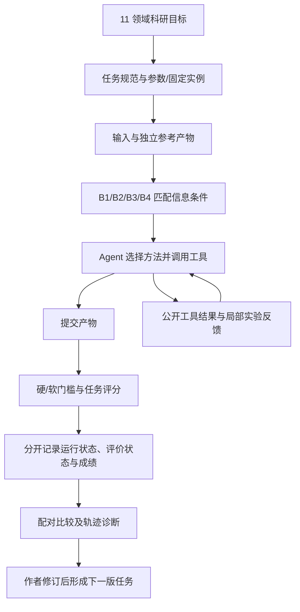
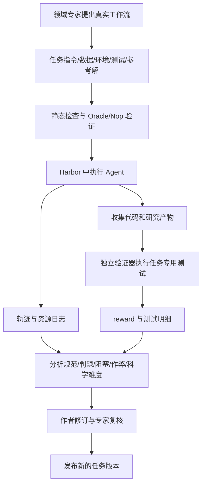

# Auto Research、科学 Agent 与 RSI：参考基准调研

更新：2026-10-24。本文将论文定位、固定源码事实与本项目设计推论分开。ASI-Bench 源码固定在 [`b100ade`](https://github.com/apexin-ai/ASI-Bench/tree/b100adef1acef9e38cc2cea298f2d07a8cc1fd84)，Terminal-Bench-Science 固定在 [`de562a2`](https://github.com/harbor-framework/terminal-bench-science/tree/de562a2863f372795d7dd09ff28876f779b3aa33)。不把不同版本的任务数、模型成绩或运行环境混作同一次实验。

## 1. 研究问题及相关工作

Auto Research 是自主选择方法、实验、解释反馈并形成可验证产物的工作流；AI Scientist 常进一步覆盖提出想法、文献、写作与审稿。RSI 要求改进对象包含 Agent 自身的代码、策略或模型，并验证改进能迁移到后续任务；仅改当前求解器不足以证明 RSI。

| 工作 | 任务与环境 | 评估及反馈 | 对本项目的启示与局限 |
|---|---|---|---|
| [AI Scientist v2](https://arxiv.org/abs/2504.08066)；[代码](https://github.com/SakanaAI/AI-Scientist-v2) | 自动提出假设、运行 ML 实验、写论文；实验管理与树搜索 | 实验指标和图文审查，包含外部论文评审 | 借鉴“假设—实验—证据—修订”；论文质量不能简化为一个数值正确率，也不提供本项目所需的精确数值真值 |
| [ScienceAgentBench](https://arxiv.org/abs/2410.05080)；[代码](https://github.com/OSU-NLP-Group/ScienceAgentBench) | 数据驱动科学任务，Agent 编写可执行分析程序 | 任务产物的程序化核验 | 借鉴产物验证；完成既定数据分析不等价于提出原创理论 |
| [MLGym](https://arxiv.org/abs/2502.14499)；[代码](https://github.com/facebookresearch/MLGym) | 在可执行研究环境中修改算法、训练和评估 | 任务指标驱动迭代，保存实验轨迹 | 借鉴公开反馈与资源成本；不同任务指标与预算需单独校准 |
| [Darwin Gödel Machine](https://arxiv.org/abs/2505.22954)；[代码](https://github.com/jennyzzt/dgm) | 修改 Agent 自身代码，保留不同后继 Agent | 用编程基准实测候选改动 | 为 RSI 提供更强定义；编程基准进步不能自动外推为科学研究能力 |
| ASI-Bench | 同一科研项目按 B1–B4 撤除指导 | 配对任务、产物门槛和连续评分 | 借鉴指导强度控制；需防止将指导差异与预算、环境差异混淆 |
| Terminal-Bench-Science | 专家提出的跨学科真实终端工作流 | 独立任务测试、Oracle/Nop、对抗检查和轨迹归因 | 借鉴任务质量闭环；专家真实任务的制作成本与依赖较高 |

本项目选择科学计算：能够构造独立真值、固定数据与环境、精确区分方法失败和运行故障，三条任务可在个人机器执行。代价是领域和生成分布有限，不代表真实科研的开放性。

## 2. ASI-Bench：在匹配项目内测量自主性

### 论文设计

[论文](https://arxiv.org/html/2608.17271v1)提出 60 个项目级任务、11 个领域，并在同一科学目标、输入和评价下改变方法信息：B1 给出方法和详细过程，B2 保留方法指导，B3 只给目标、数据与约束，B4 额外加入正确但无关的信息。核心可观察量是撤除指导后，Agent 能否自己选择并完成研究方法。领域覆盖数学、物理、化学、生物、天文、材料、地球、医学与生物统计、计算机、机器人、电气工程。

配对条件比直接拿不同题目比较更能定位方法选择负担，但单次得分差异仍不是严格的认知因果识别。论文的多轮专家审查、沙箱验收和评分验证属于任务构建质量控制；不能据此宣称所有个别 scorer 永远无误。

### 数据和代码执行链

源码采用任务规范、实例输入、参考产物和任务评分配置。实例生成器支持固定设置列表及按种子采样参数，也支持预计算实例；并非每条任务都用同一种随机生成算法。[实例生成器](https://github.com/apexin-ai/ASI-Bench/blob/b100adef1acef9e38cc2cea298f2d07a8cc1fd84/ai4sci_bench/generators/instance_generator.py#L127)分别处理有限设置、随机参数与已有参考。公开 `seed31415` 提供本地评分参考，`seed42` 的参考保持私有；这两套数据不能混为相同可见性。[README](https://github.com/apexin-ai/ASI-Bench/blob/b100adef1acef9e38cc2cea298f2d07a8cc1fd84/README.md#L149)

评分的关键路径是 [`core/scoring.py`](https://github.com/apexin-ai/ASI-Bench/blob/b100adef1acef9e38cc2cea298f2d07a8cc1fd84/ai4sci_bench/core/scoring.py#L106)：先执行 hard/soft gates，硬门槛决定是否进入主评分，软门槛记录失败并按配置处罚，后续 scorer 汇总。任务配置可指定硬失败的分数策略，不能一概说所有硬失败都完全相同。`CompositeScorer` 负责子评分加权，本身不承担门槛编排。[CompositeScorer](https://github.com/apexin-ai/ASI-Bench/blob/b100adef1acef9e38cc2cea298f2d07a8cc1fd84/ai4sci_bench/scorers/composite.py#L10)

[`local_scoring.py`](https://github.com/apexin-ai/ASI-Bench/blob/b100adef1acef9e38cc2cea298f2d07a8cc1fd84/ai4sci_bench/local_scoring.py#L527)保存 gate、score、失败种类和 evaluation 状态；评分器内部异常会导致评价无效，不应算作 Agent 的科学零分。分数是产物判断，轨迹和配对条件才是归因证据；不能从总分直接推断模型“不会思考”。

### 逻辑框图与自迭代边界

[交互逻辑图与源码引用](../.archify/workflow-asi-bench-20261024-1200/asi-bench.html)

内环由被测 Agent 根据允许的反馈修改方案；外环由作者分析任务与评分问题后发布修订。上图不把隐藏评分回灌同一研究会话，也不假定框架会自动修改 Agent 自身。

## 3. Terminal-Bench-Science：真实科研工作流的可验证产物

### 官方文献与版本

本次核对的官方引用是软件发布 DOI：[概念 DOI](https://doi.org/10.5281/zenodo.22110253)、[v0.1.0 DOI](https://doi.org/10.5281/zenodo.22110254)，`CITATION.cff` 标明 `type: software`。[官方发布说明](https://www.tbench.ai/news/terminal-bench-science-0-1)与代码是本节依据；未将 Terminal-Bench 2.0 的论文冒称为 Science 的独立论文。0.1 发布为 70 个任务；本地后续源码 README 显示 71，二者属于不同快照。

领域为生命、物理、地球、数学和工程科学。基本单元是领域专家实际研究流程中的工作：Agent 在终端环境完成分析、模拟、代码、证明或数据产物，任务专用测试核验输出。它更侧重任务真实性与客观验收，没有与 ASI-Bench 相同的全局 B1–B4 指导设计。

### 任务包与自动分析

任务包括 `instruction.md`、`task.toml`、`environment/`、`tests/` 和 `solution/`，可附作者数据与证据。数据可以来自真实研究、模拟或任务专用生成器；不能把仓库统一描述成“全是合成数据”。环境、资源、Agent 与 verifier 的预算由任务配置控制。

以 [`traffic-flux-inversion`](https://github.com/harbor-framework/terminal-bench-science/tree/de562a2863f372795d7dd09ff28876f779b3aa33/tasks/mathematical-sciences/applied-mathematics/traffic-flux-inversion) 为代码案例：根据稀疏观测识别通量规律及隐藏混合控制机制，并迁移到新系统、网格和时域。`task.toml` 为 separate verifier 且 verifier 无网络。`tests/test.sh` 锁住测试和评分目录，以非特权用户执行候选，清除残留进程，再由可信 pytest 生成 reward。`test_flux.py` 检查输出类型/形状/有限性、初值一致性、参数识别、公开观测一致性、隐藏平滑/激波、控制激励和网格时域迁移。这证明该任务如何避免只靠公开拟合过关；不代表全部任务都采用相同门槛。

任务质量检查与最终科学评分也是两层。构建流程有环境构建、Oracle 应通过、Nop 应失败、对抗作弊试验和专家审查。[自动化入口](https://github.com/harbor-framework/terminal-bench-science/blob/de562a2863f372795d7dd09ff28876f779b3aa33/TASK_REVIEW_AUTOMATION.md)；[试验分析 rubric](https://github.com/harbor-framework/terminal-bench-science/blob/de562a2863f372795d7dd09ff28876f779b3aa33/rubrics/trial-analysis.toml)分别审查规范完整性、解法可发现性、验证器正确性、边界公平性、拒绝、外部阻塞、非正当得分与有意义难度。分析模型给出的是待复核诊断，不能替代数值真值，也不是保证无误的自动根因定位器。

### 逻辑框图与版本闭环

[交互逻辑图与源码引用](../.archify/workflow-terminal-bench-science-20261024-1200/terminal-bench-science.html)

持续改进主要是 benchmark 的任务维护闭环；研究 Agent 是否在会话内部迭代，取决于其实现和任务允许的反馈。持续发布不是模型权重自动递归改进的证据。

## 4. 本项目的设计取舍与后续计划

| 设计问题 | 采用方案 | 理由与边界 |
|---|---|---|
| 领域 | 科学计算：热逆问题、动力学辨识、稀疏求解优化 | 三类方法选择难点；可独立核验真值，合成分布限制外推 |
| 指导控制 | G1 详细方法、G2 方向、G3 共同契约 | 借鉴 ASI 的匹配设计；G2 不提供具体算法名，不等于 B2，未设 B4 |
| 数据 | 每任务 dev6/calibration12/final12，90 例 | 公开探索与隐藏评分分离；不以模型成绩选择实例 |
| 实验 | 固定 Pi、模型参数、镜像、资源与提示；可信提交登记 | 区分模型/方法问题与接口、运行和计时问题 |
| 评分 | 数值正确性、连续科学效果、T3 资源与速度；first/final 重放 | 隐藏评价不回灌研究；跨任务评分不直接平均 |
| 归因 | 提交失败、重复计算、持续模拟未提交、API/控制器故障、计时无效分别统计 | 不根据一条错误消息猜测模型内部原因 |
| 复现 | 生成器/QC、依赖锁、数据哈希、候选快照、独立重放及日志 | 同机复现不等于跨平台逐字节复现；速度需新环境重新准入 |

实施顺序是：先冻结科学问题与产物契约 → 生成数据与独立 QC → 跑强弱作者基线并验证评分器 → 验收隔离和资源 → 冻结 Agent 设置与运行顺序 → 公开研究 → 关闭提交后隐藏重放 → 失败归因和成本报告 → 发布可复现材料。当前完成情况与证据见[提交报告](submission-report-2026-10-24.md)。

下一阶段才考虑新隐藏集、跨模型/种子重复、预算配对试验和 Agent 自修改实验。任何接口或 Agent 优化须新版本冻结，不能事后改写本轮结果。额外的 50 万 token 选择性补跑已取消，取消记录单列。当前[最终报告](submission-report-2026-10-24.md)仅列 thinking/max 实验，披露执行器修复、关联重试和计时拒绝。上一版跨批分析已独立暂存，原始记录保留。
